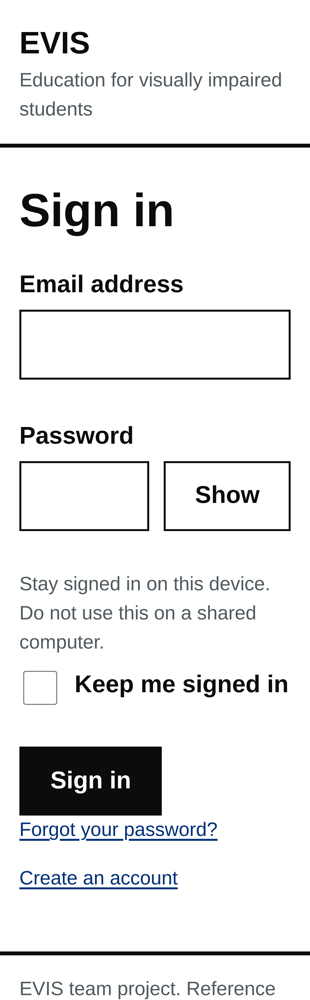
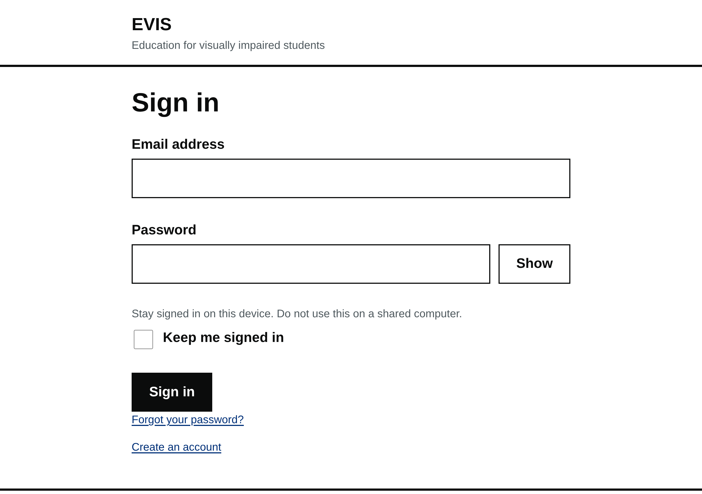
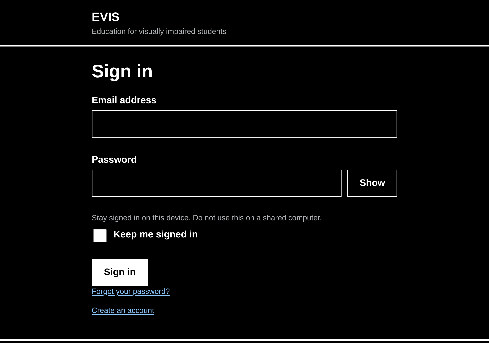
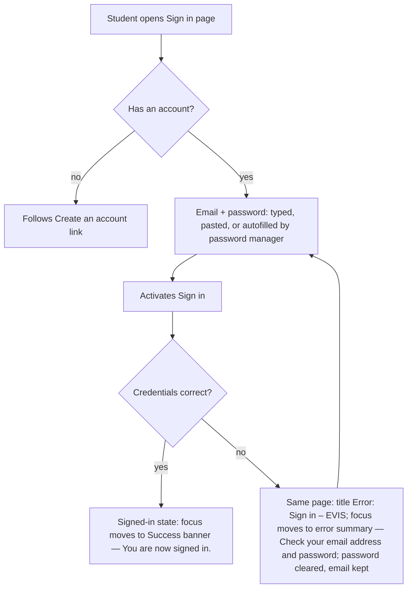
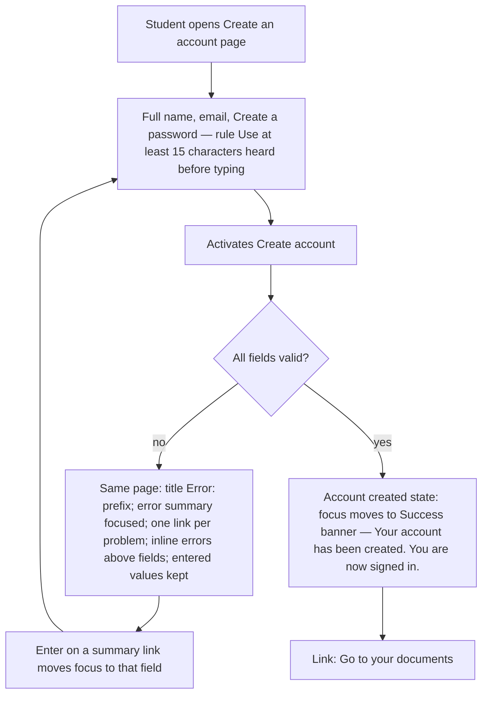
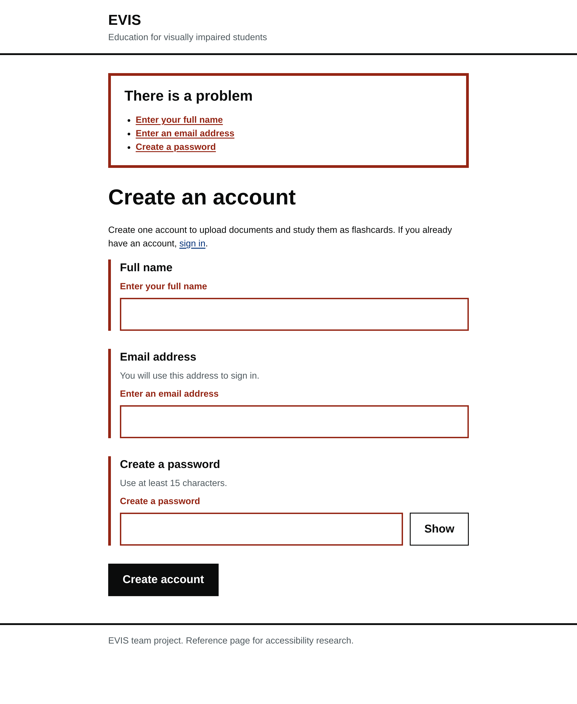

# Accessible UI/UX Research for EVIS

**Project:** Education for visually impaired students (EVIS)
**Document:** 05_Accessible_UIUX_Research.md
**Date:** 2026-11-16
**Author:** Zaharia Iulian (research), with AI assistance (see [14.4](#144-ai-assistance-note))
**Status:** research complete, ready to design and build from
**Scope:** research document only — no application code is changed by this document

This document answers one question: *how do students who cannot see, and students who can barely see, actually sign in, register, and use EVIS — and what exactly must the interface do to support them?* It is built from published user studies with blind and low-vision people, from large user surveys, from design systems that already solve authentication accessibly, and from a reference implementation that was built and machine-checked while writing this document (axe-core plus accessibility-tree checks, 57/57 passed; see [8.7](#87-reference-implementation-validated)).

Everything is in English. The proposed interface wording is English and the reference pages use `lang="en"`. Romanian wording and localisation are deferred (see [12.2](#122-localisation-deferred)). Voice interaction is also deferred to a later version, with the limits recorded in [12.1](#121-voice-interaction-deferred).

## Contents

1. [Summary: the decisions and the ten rules that matter most](#1-summary-the-decisions-and-the-ten-rules-that-matter-most)
2. [Who the students are](#2-who-the-students-are)
3. [How a blind student signs in and registers](#3-how-a-blind-student-signs-in-and-registers)
4. [How a low-vision student uses the same screens](#4-how-a-low-vision-student-uses-the-same-screens)
5. [What goes wrong in real life](#5-what-goes-wrong-in-real-life)
6. [Real products to copy](#6-real-products-to-copy)
7. [The UI/UX rules](#7-the-uiux-rules)
8. [Screen specifications](#8-screen-specifications)
9. [The other EVIS screens](#9-the-other-evis-screens)
10. [WCAG 2.2 AA checklist](#10-wcag-22-aa-checklist)
11. [Test plan](#11-test-plan)
12. [Deferred: voice and localisation](#12-deferred-voice-and-localisation)
13. [Gaps in the repository and draft requirements](#13-gaps-in-the-repository-and-draft-requirements)
14. [Videos, sources and how this document was checked](#14-videos-sources-and-how-this-document-was-checked)

## 1. Summary: the decisions and the ten rules that matter most

### 1.1 Decisions this document is built on

| Topic | Decision | Why |
|---|---|---|
| Deliverable | Research document only; no code changes | Team designs and builds from this document; code follows in a feature branch |
| Sign-in method | Email address + password, designed for password managers | Password managers are the single biggest accessibility win for authentication: all 33 respondents in the CISPA 2025 study used them ([5.3](#53-cispa-helmholtz-study-2025)); WCAG 2.2 requires authentication to work with them (3.3.8) |
| Voice interaction | Not in the first version | Browser voice APIs cannot be relied on (see [12.1](#121-voice-interaction-deferred)); screen reader + keyboard is the proven path |
| Language | English only (`lang="en"`) | Romanian wording and localisation deferred to avoid premature abstraction ([12.2](#122-localisation-deferred)) |
| Screen reader detection | Never | It is unreliable and widely advised against ([12.1](#121-voice-interaction-deferred)); any mode is chosen by the student, never guessed |
| Biometrics / passkeys | Out of scope for v1; noted for later | Passkey flows are promising for accessibility but need platform support ([6.4](#64-password-managers-and-passkeys-as-accessibility-features)) |

### 1.2 The ten rules that matter most

The full numbered rule list is in [section 7](#7-the-uiux-rules). These ten decide whether a blind or low-vision student can use EVIS at all:

1. **One form per page, at the top, one visible way to sign in** (R5, R6). Blind users wasted the most time *locating* the login area (87 s across 13 attempts in the Dosono study, [5.1](#51-dosono-hayes--wang--im-stuck-soups-2015)).
2. **Validate only on submit, and never with the browser's native popups** — `novalidate` on the form, no `required` attributes (R10, R11). Native popups are inconsistently announced and move focus unpredictably.
3. **On error: prefix the page title with "Error: ", show an error summary at the top, and move focus to it** (R20–R22). This is the GOV.UK pattern; the title prefix is what tells a screen reader user something went wrong before anything is read.
4. **Every error appears twice with identical wording**: once as a link in the summary, once inline above the field, tied to the field with `aria-describedby` (R22, R23).
5. **Every success is spoken explicitly**: a success banner that receives focus ("Success — You are now signed in.") (R26). In the Napoli study, websites often gave *no* audible success confirmation, so users guessed ([5.2](#52-napoli-et-al--im-literally-just-hoping-this-will-work-soups-2021)).
6. **One password field, no confirm-password, and a Show password button that announces its state but never speaks the password** (R16, R18).
7. **Password-manager friendly fields**: correct `autocomplete` tokens, paste allowed, no `maxlength` (R9, R10, R19).
8. **Two high-contrast themes, light and dark, every text pair at least 7:1, forced-colors supported** (R32–R34). 51.4% of low-vision survey respondents use a high-contrast mode and 71.2% of those prefer light text on dark ([2.2](#22-low-vision-students-what-the-surveys-say)).
9. **Big text that scales: 20px base, single column, reflow at 400% zoom / 320px with no horizontal scrolling** (R37, R39, R40). 17.9% of low-vision respondents zoom to 400% or more.
10. **An unmistakable focus indicator on every theme** — dark outline plus yellow halo, GOV.UK style (R29).

The reference pages in [section 8.7](#87-reference-implementation-validated) implement all of this and pass all 57 automated checks.

## 2. Who the students are

EVIS serves two overlapping groups. Many students use *both* a screen reader and magnification/high contrast, and the two paths must work at the same time.

### 2.1 Blind students: what the surveys say

From the [WebAIM Screen Reader Survey #10](https://webaim.org/projects/screenreadersurvey10/) (published January 2024):

| Fact | Number | Consequence for EVIS |
|---|---|---|
| Most common primary desktop/laptop screen reader | JAWS 40.5%, NVDA 37.7%, VoiceOver (macOS) 9.7% | Test with NVDA and JAWS first; VoiceOver third |
| Primary screen reader among European respondents | NVDA 37.2%, JAWS 29.7% | For a Romanian/European student body, NVDA is the most likely primary tool |
| Use more than one desktop/laptop screen reader regularly | 71.6% | Do not optimise for one screen reader's quirks; keep semantics standard |
| Use a screen reader on mobile | 91.3% | The auth pages must work with VoiceOver (iOS) and TalkBack (Android) |
| Most common operating system | Windows 86.1% | NVDA/JAWS on Windows is the primary test platform |
| Most common first strategy for a new page | Navigate by headings | One `h1` per page and a correct heading outline are navigation, not decoration |

From [Azenkot & Lee, ASSETS 2013](https://dl.acm.org/doi/10.1145/2513383.2513440) ("Exploring the use of speech input by blind people on mobile devices"): blind smartphone participants used speech input nearly 5 times more than the on-screen keyboard, and spent **80.3%** of their input time *editing and correcting* what they typed. Consequence: minimise typing (autofill, paste, no confirm-password field) and make correction painless (errors that move focus to the exact field).

### 2.2 Low-vision students: what the surveys say

From the [WebAIM Survey of Users with Low Vision #2](https://webaim.org/projects/lowvisionsurvey2/) (conducted September 2018, 248 valid responses):

| Fact | Number | Consequence for EVIS |
|---|---|---|
| Use screen magnification software | 48.4% | Design for a small visible window of the page ([4.1](#41-the-magnifier-student-400-zoom)) |
| Use a high-contrast mode or scheme | 51.4% | Ship a high-contrast dark theme and respect the OS setting |
| Of high-contrast users, prefer light text on dark background | 71.2% | Dark theme is not a preference toggle luxury; for most it is the default need |
| Enlarge text to 400% or larger | 17.9% | Reflow at 400% (320 CSS px wide) with no horizontal scrolling — WCAG 1.4.10 |

Respondents commonly have multiple impairment types and combine techniques (magnification + screen reader, browser zoom + text sizing). The [W3C Low Vision User Requirements](https://www.w3.org/TR/low-vision-needs/) document is the reference for these needs.

### 2.3 What this means for EVIS

- **Primary path:** keyboard + screen reader (NVDA on Windows most likely, then JAWS, then VoiceOver; VoiceOver/TalkBack on phones). Everything in [section 3](#3-how-a-blind-student-signs-in-and-registers) is written for this path.
- **Second path:** magnification up to 400%, high-contrast themes, browser zoom. Everything in [section 4](#4-how-a-low-vision-student-uses-the-same-screens).
- **Design constant:** standard HTML semantics, real labels, visible text, no custom widgets. 71.6% of users switch between screen readers — clever ARIA that works in one breaks in another.

## 3. How a blind student signs in and registers

This section is the real-world walkthrough the team asked for: what a person who cannot see does, key by key, and what the page must provide at every step. It uses the reference pages in [section 8.7](#87-reference-implementation-validated), which are built exactly to the rules in [section 7](#7-the-uiux-rules).

> **Important:** the exact spoken wording below ("edit protected", "secure edit text", …) is taken from published screen-reader support tables (TetraLogical, PowerMapper, a11ysupport.io — see [14.2](#142-full-source-list)). This author cannot listen to a screen reader in this environment, so every spoken string is marked **to confirm**. [Section 11.3](#113-screen-reader-scripts) gives the team short scripts to confirm each one with real screen readers before merge.

### 3.1 The setup

The most common combination in the surveys: **NVDA with Chrome or Firefox on a Windows laptop**. A student who cannot see does not use a mouse at all: everything below is keyboard-only. NVDA keys used: `Tab` (next focusable item), `H` (next heading), `F` (next form field), `K` (next link), `Enter`/`Space` (activate), `NVDA+T` (read page title), arrow keys (read text).

### 3.2 Signing in, step by step (NVDA on Windows)

| # | Student does (keys) | What the student hears (to confirm) | What the page must provide |
|---|---|---|---|
| 1 | Opens the sign-in URL | Page title: "Sign in – EVIS" | Unique `<title>` per page; `lang="en"` so pronunciation is right (R1) |
| 2 | Presses `H` to find the page structure | "Sign in, heading level 1" — the first and only h1, near the top | One `h1` matching the page purpose; form is the first thing in `<main>` (R3, R5). In the Dosono study, locating the login area was the biggest time sink (D1, [5.1](#51-dosono-hayes--wang--im-stuck-soups-2015)) — no navigation menu or marketing links before the form |
| 3 | Presses `F` (or `Tab`) to reach the first field | "Email address, edit" | Visible `<label for="email">` above the input; no placeholder-as-label (R8); `autocomplete="email"` so the browser/password manager can fill it (R9) |
| 4 | Types or pastes the email address | Each character echoed; nothing else | `spellcheck="false"` so the screen reader does not say "misspelled" for the address; paste allowed (R13) |
| 5 | Presses `Tab` | "Password, edit protected" (NVDA). JAWS: "password edit". VoiceOver (mac): "secure edit text" | `type="password"` + `autocomplete="current-password"` (R9). The screen reader itself tells the user the field is protected — the page must not add its own "(password)" text |
| 6 | Types the password | "star … star … star" per character (NVDA/JAWS). VoiceOver (mac): a masked noise per character, characters not spoken | This is the screen reader's masking behaviour; the page must never speak, echo, or print the password (R18). Students rely on "star" feedback to know typing worked — a Dosono participant: "star, star, star, so they don't know if they hit the wrong key" ([5.1](#51-dosono-hayes--wang--im-stuck-soups-2015)); that is why wrong keystrokes must be recoverable — see step 7 |
| 7 | Optional: `Tab` to "Show", `Space` | "Show, button" → after press: "Your password is shown" (status) | Show-password button: `type="button"`, `aria-controls`, label toggles "Show password"/"Hide password", hidden `role="status"` region announces the *state*, never the value (R18, GOV.UK password input component). This also repairs the masking problem: a student who mistyped can look (or ask a sighted peer) without losing the account |
| 8 | `Tab` | "Keep me signed in, checkbox, not checked. Stay signed in on this device. Do not use this on a shared computer." | Checkbox with visible label; hint tied with `aria-describedby` (R8); unchecked by default (R41) |
| 9 | `Tab`, then `Space` or `Enter` | "Sign in, button" → activates | Submit button with the same wording as the page title/h1 — consistent terminology (R7) |
| 10a | **Success:** page changes | Title "Signed in – EVIS"; focus lands on the banner: "Success, heading level 2 … You are now signed in." | Navigate to a real success state; success banner with `role="alert"`, `tabindex="-1"`, focus moved to it on load (R26). Never leave the user in silence — Napoli found users had to infer success from the *absence* of errors ([5.2](#52-napoli-et-al--im-literally-just-hoping-this-will-work-soups-2021)) |
| 10b | **Failure:** page stays | Title becomes "Error: Sign in – EVIS"; focus lands on: "There is a problem, alert … Check your email address and password, link" | Title prefixed "Error: " (R20); error summary at top, focused (R21); one link per problem (R22); email kept, password cleared (R12); the message does **not** say which of the two credentials was wrong (R25) |
| 11 | After failure: `Tab`/`Enter` on the summary link | Focus jumps to the email field; inline error read via description | Summary links jump to the exact field (R22); inline error tied with `aria-describedby`, identical wording (R23); `aria-invalid="true"` set but never the only signal (R24) |

### 3.3 JAWS and VoiceOver differences the team must know

Announcement differences per field type (from the [TetraLogical screen-reader HTML support tables](https://tetralogical.github.io/screen-reader-HTML-support/) and [PowerMapper tests](https://www.powermapper.com/tests/screen-readers/); **to confirm** with our own scripts):

| Element | NVDA | JAWS | VoiceOver (macOS) | VoiceOver (iOS) | TalkBack (Android) |
|---|---|---|---|---|---|
| Password input (labelled) | "edit protected" | "password edit" | "secure edit text" | "secure text field" | "Password edit box" |
| Character typed in password | "star" | "star" | not spoken (masked noise) | character spoken | character spoken in masked form |
| Error text via `aria-describedby` | read with the field | read with the field | read with the field | read with the field | read with the field |
| `aria-invalid="true"` | announced ("invalid") | announced | announced | announced | **not consistently announced** ([a11ysupport.io test](https://a11ysupport.io/tests/tech__aria__aria-invalid)) |
| `role="alert"` region | announced | announced | announced | announced | announced, with caveats ([a11ysupport.io](https://a11ysupport.io/tech/aria/alert_role)) |

Consequences, and they are already rules:

- Error text **must** be in the field's `aria-describedby` and in a focused summary — never rely on `aria-invalid` or a live region alone (R21–R24).
- Navigation differs: NVDA/JAWS users press `H`/`F`/`K`; VoiceOver users swipe and use the rotor; TalkBack users swipe and use the local menu. All of them rely on the same landmarks, headings, and labels — which is why the rules are about semantics, not about any one screen reader (R1–R8).
- A JAWS user's recovery move when a page wedges the synthesiser is brutal: "I can unload JAWS and reload it because that will fix the problem. If it doesn't read anything like before, I restart it again." (Napoli, [5.2](#52-napoli-et-al--im-literally-just-hoping-this-will-work-soups-2021)). A page that steals focus or fires stray live regions can literally cost a student a screen-reader restart.

### 3.4 Signing in on a phone (VoiceOver iOS / TalkBack)

| # | Student does | What happens (to confirm) | Page requirement |
|---|---|---|---|
| 1 | Swipe right through the page | Heading "Sign in", then "Email address, text field" | Same DOM as desktop; heading-first navigation works on mobile too |
| 2 | Double-tap the email field | On-screen keyboard appears | No `autofocus` (R15) — the student controls when the keyboard opens; iOS AutoFill bar appears above the keyboard when `autocomplete="email"`/`current-password` is present (R9) |
| 3 | Type | VoiceOver iOS speaks typed characters, even in the password field ("secure text field"); TalkBack speaks them masked | Nothing to do — but it shows why the page must never *itself* display or speak the password (R18) |
| 4 | Tap/activate "Sign in" | As desktop: success banner focused, or error summary focused | Identical error/success machinery (R20–R26); the reflowed single column means nothing is off-screen at phone widths (R39) |

Remember the Azenkot & Lee finding: on phones, blind users spend **80.3%** of input time editing and correcting ([2.1](#21-blind-students-what-the-surveys-say)). Autofill and paste are not conveniences on mobile — they are the difference between a 30-second and a 5-minute sign-in.

### 3.5 The password-manager route (the fastest path, and the one to design for)

All 33 respondents in the CISPA 2025 study used password managers, "sometimes consciously, sometimes unconsciously, simply because their browser or device offered to manage them" ([5.3](#53-cispa-helmholtz-study-2025)). For blind students the manager removes the hardest part entirely: typing an unseen random password.

| Route | Student does | Page requirement |
|---|---|---|
| Bitwarden (desktop) | Focus the page, press `Ctrl/Cmd + Shift + L` ("auto-fill the last used login") — [Bitwarden keyboard shortcuts](https://bitwarden.com/help/keyboard-shortcuts/) | Email and password fields must be adjacent, standard, and carry `autocomplete="email"` + `autocomplete="current-password"` so the extension detects them (R9) |
| Chrome/Firefox built-in | `Tab` into the email field; browser offers the saved credential; `Enter` accepts | Nothing may block autofill: no `readonly` tricks, no `maxlength`, no CAPTCHA (R10, R14) |
| iOS AutoFill | AutoFill button above the keyboard → Face ID/Touch ID → filled | Correct autocomplete tokens; standard inputs |
| Registration (iOS) | Safari offers "Use Strong Password" ([Apple: automatically fill in strong passwords](https://support.apple.com/guide/iphone/automatically-fill-in-strong-passwords-iphf9219d8c9/ios)) | `autocomplete="new-password"` on the single password field (R9, R16); allow paste (R19); no confirm-password field so the manager fills once |

Napoli's study adds the trust dimension: because managers fill masked fields, users could not verify what was filled, which undermined the perceived usefulness of the manager ([5.2](#52-napoli-et-al--im-literally-just-hoping-this-will-work-soups-2021)). The Show-password button plus its spoken state ("Your password is shown") is how EVIS restores that verifiability without speaking the secret.

### 3.6 Creating an account — including a mistake and its correction

The registration walkthrough with a realistic mistake. Same equipment (NVDA + keyboard).

| # | Student does (keys) | What the student hears (to confirm) | What the page must provide |
|---|---|---|---|
| 1 | Opens create-account URL, presses `H` | "Create an account, heading level 1", then paragraph: "Create one account to upload documents and study them as flashcards. If you already have an account, sign in, link." | Wording is "Create an account" — never "Register" or "Sign up" (R7, GOV.UK create-accounts pattern); the intro sets context before the form |
| 2 | `F` → first field | "Full name, edit" | `autocomplete="name"` (R9) |
| 3 | Types name; `Tab` | "Email address, edit. You will use this address to sign in." | Hint read with the field via `aria-describedby` (R8) |
| 4 | Types email; `Tab` | "Create a password, edit protected. Use at least 15 characters." | **The rule is stated before the field**, in its description, so the student hears it before typing — not after failing (R8, R17, GOV.UK passwords pattern) |
| 5 | **Mistake:** leaves full name empty, types a 12-character password, `Tab`, `Space` on "Create account" | Title: "Error: Create an account – EVIS". Focus: "There is a problem, alert. Enter your full name, link. Create a password with at least 15 characters, link." | Validate on submit only (R11); summary focused, one link per problem, links worded exactly like the inline errors (R20–R22); what the student typed is kept (R12) |
| 6 | `Tab` to first link, `Enter` | Focus moves to Full name; field described by "Error: Enter your full name" | Summary link → field focus; inline error above the field, identical wording, `aria-describedby` (R22, R23); group marked with a left border so a magnifier user sees it too |
| 7 | Types name; `Tab` to password link in summary (or `F`), `Enter` | Focus moves to password; "Create a password, edit protected. Use at least 15 characters. Error: Create a password with at least 15 characters." | Same machinery; the student can re-read the rule and the error together |
| 8 | Types a 20-character passphrase, optionally presses Show to verify, submits | Success: title "Account created – EVIS"; focus: "Success, heading level 2 … Your account has been created. You are now signed in." | Single password field — no confirm-password (R16); explicit success banner, focused (R26); account creation signs the student in, one step |

There is no CAPTCHA (R14) and no security question anywhere — security questions cost a Dosono participant 166 seconds (D10) and NIST SP 800-63B-4 forbids them.

### 3.7 Forgot password

| # | Student does | Hears (to confirm) | Page requirement |
|---|---|---|---|
| 1 | From sign-in, `K` → "Forgot your password?", `Enter` | Title "Reset your password – EVIS"; h1 + instructions read | Descriptive link text (R7); instructions before the form |
| 2 | Types email, submits | Success panel focused: "Check your email, heading level 2 … If an account exists for ana@example.com, we have sent a link to reset the password. The link stops working after 30 minutes." | Form replaced by a focused success panel (R26); the email is echoed so the student can verify *which* address was used; identical message whether or not the account exists (no account enumeration); link expiry stated |
| 3 | Reads the reset email, opens the link | New page with the same error/success machinery | The emailed link must have descriptive text; the reset page reuses every rule in this document |

## 4. How a low-vision student uses the same screens

### 4.1 The magnifier student: 400% zoom

A student using Windows Magnifier (`Win` + `+`) or browser zoom at 400% sees a **small moving window** of the page — often only a few words at a time ([TetraLogical: browsing with screen magnification](https://tetralogical.com/blog/2021/11/10/browsing-with-screen-magnification/)). What that demands:

| Requirement | Rule | Why |
|---|---|---|
| Single column, max ~40rem wide, left-aligned | R39 | At 320 CSS px there must be nothing to scroll horizontally (WCAG 1.4.10 reflow) — figure 4 shows exactly this |
| Label, hint, and error directly above each field | R8, R23 | The label and the field must fit in one magnified viewport; a label far from its field disappears off-screen (TetraLogical low-vision guidance) |
| Error summary at the top, focus moved to it | R21 | The magnifier follows focus — moving focus to the summary scrolls the student to the problem automatically |
| No fixed heights, no sticky headers, no toasts | R27 | Fixed heights clip enlarged text; sticky headers eat the small viewport; timed toasts vanish before they can be panned to |
| Key content top-left | R5 | Magnifier users start at the top-left; the form must already be there |



*Figure 4: the reference sign-in page at a 320 CSS px viewport (rendered at 4× to represent 400% zoom). One column, no horizontal scrolling, focus indicator and text all legible.*

### 4.2 The high-contrast student: themes

51.4% of low-vision survey respondents use a high-contrast mode, and 71.2% of those prefer **light text on a dark background** ([2.2](#22-low-vision-students-what-the-surveys-say)). EVIS therefore ships two themes, both high-contrast, and follows the OS by default:

| Colour pair | Ratio | Where |
|---|---|---|
| **Light theme** | | |
| `#0B0C0C` text on `#FFFFFF` | **19.59:1** | body text |
| `#505A5F` on `#FFFFFF` | **7.07:1** | hints, secondary text |
| `#003078` on `#FFFFFF` | **12.40:1** | links |
| `#942514` on `#FFFFFF` | **8.29:1** | error text and borders |
| `#FFFFFF` on `#005A30` | **8.38:1** | success banner |
| `#0B0C0C` on focus yellow `#FFDD00` | **14.55:1** | focused links |
| **Dark theme** | | |
| `#FFFFFF` on `#000000` | **21.00:1** | body text |
| `#B1B4B6` on `#000000` | **10.07:1** | hints, secondary text |
| `#8CC8FF` on `#000000` | **11.82:1** | links |
| `#FF9A8F` on `#000000` | **10.27:1** | error text |
| `#000000` on `#7FE5A0` | **13.62:1** | success banner |

Every text pair is at least **7:1** — well beyond the AA minimum of 4.5:1 (rule R33). Ratios recomputed by script on 2026-11-16 ([14.3](#143-how-this-document-was-checked)). When a link receives focus its text becomes black on the yellow focus background in both themes (14.55:1); white on `#FFDD00` would be 1.35:1, which is why the rule forces black text on focus yellow.

The theme logic (from the validated `styles.css`):

- Default follows the OS: `prefers-color-scheme: dark` selects the dark theme.
- A user override (`data-theme="light"` / `"dark"`) wins over the OS and is persisted — chosen by the student, never detected from their assistive technology.
- Windows High Contrast / Forced Colors Mode is supported via `@media (forced-colors: active)`: borders switch to system colours and the focus outline uses `Highlight`, so the focus indicator survives when the OS repaints colours (R34).



*Figure 1: reference sign-in page, light theme — 20px base text, 25px labels and inputs, dark outline + yellow focus halo.*



*Figure 2: the same page, dark theme — white on black (21:1), the preference of 71.2% of high-contrast users.*

### 4.3 The browser-zoom student: text size

- Base text **20px**, labels/inputs/buttons **25px**, `h1` ≈ 48px — everything in `rem`, so browser text zoom scales the whole layout (R37).
- Zoom must remain usable at **250%** (WCAG 1.4.4) and reflow cleanly at **400%** (WCAG 1.4.10), because 17.9% of low-vision respondents go to 400% or more (R39, R40).
- Sans-serif font, no italics, no all-caps text blocks; large-print guidance (16–20pt equivalent) comes from [APH](https://aphconnectcenter.org/visionaware/living-with-blindness-or-low-vision/daily-living-skills/large-print/) and [Sensory Trust](https://www.sensorytrust.org.uk/resources/guidance/designing-with-clear-and-large-print).
- Font candidate: [Atkinson Hyperlegible Next](https://github.com/googlefonts/atkinson-hyperlegible-next) — designed by the Braille Institute for low-vision readers, open source, with a fallback stack of Verdana/Tahoma/Arial in the reference CSS.

## 5. What goes wrong in real life

Three studies observed real blind and low-vision people authenticating on real sites. Every problem below is mapped to the rule that prevents it in EVIS.

### 5.1 Dosono, Hayes & Wang — "I'm Stuck!" (SOUPS 2015)

["I'm Stuck!": A Contextual Inquiry of People with Visual Impairments in Authentication](https://www.usenix.org/conference/soups2015/proceedings/presentation/dosono). Contextual inquiry: the researchers watched participants authenticate on their own devices. "We recruited 12 participants who self-described as having a visual impairment, including eight blind users and four with low vision" (Syracuse, NY area, May–July 2014; 9 used JAWS, 2 ZoomText, 1 no assistive technology).

Task times (Table 1 of the paper, seconds, mean/median):

| Task | Mean | Median |
|---|---|---|
| Computer (log in to laptop) | 177 | 164 |
| Email | 97 | 57 |
| Banking | 316 | 308 |
| Commerce | 174 | 129 |
| Social networking | 63 | 63 |
| Mobile phone | 54 | 10 |

Difficulties observed (Table 2 of the paper; total seconds × occurrences) and the EVIS rule that answers each:

| # | Difficulty | Time × count | EVIS answer |
|---|---|---|---|
| D1 | **Locating the authentication area** on the page | 87 s × 13 | Form first in `<main>`, one sign-in mechanism, nothing before it (R5, R6); heading-first navigation works (R3) |
| D2 | Another user already logged in | 133 s × 1 | Show who is signed in, with an explicit Sign out (R28) |
| D3 | Waiting for screen reader output / unsure if page loaded | 35 s × 72 | Unique titles, focus management on load, explicit banners (R1, R21, R26) — never leave silence |
| D4 | **Verifying successful authentication** | 79 s × 3 | Focused success banner: "You are now signed in." (R26) |
| D5 | Entering passwords correctly | 14 s × 2 | Show-password button (R18); password-manager autofill (R19); no confirm-password (R16) |
| D6 | **Insufficient audio feedback on errors** | 89 s × 3 | "Error: " title, focused summary, inline errors via `aria-describedby` (R20–R23) |
| D7 | Fingerprint placement (biometrics) | 11 s × 1 | No biometric-only authentication in EVIS; password path always available |
| D8 | Browser stored credentials confusion | 16 s × 1 | Standard autofill, no interference; Show button makes the filled value verifiable (R18, R19) |
| D9 | Pop-ups during authentication | 33 s × 1 | No modal dialogs, no cookie walls, no CAPTCHA on auth pages (R14) |
| D10 | **Security questions** | 166 s × 1 | None, ever (R14; NIST SP 800-63B-4 forbids them) |

Participant quotes (verified against the paper text): on ambiguous controls, "I didn't know it was a button. I thought it was a link"; on password masking, "star, star, star, so they don't know if they hit the wrong key, or if the caps lock key happened to be on"; on touch targets, "…I'm never quite sure where to touch it"; on a site that remembered them, "Oh, it does remember me!" — the delight of a working session, which is exactly what "Keep me signed in" (R41) delivers.

The paper's own design implications (login form near the top and programmatically findable, one sign-in element per page, removing confusing pre-login account links, explicit success confirmation, consistent terminology, involving visually-impaired users in design) are adopted directly by rules R1–R7, R26, and the test plan in [11.5](#115-sessions-with-real-students).

### 5.2 Napoli et al. — "I'm Literally Just Hoping This Will Work" (SOUPS 2021)

[Obstacles Blocking the Online Security and Privacy of Users with Visual Disabilities](https://www.usenix.org/conference/soups2021/presentation/napoli) (Napoli, Baig, Maqsood, Chiasson — Carleton University). "Fourteen participants with visual disabilities (7 blind, 7 partially sighted), completed three phases of the 90-minute study" (Ottawa/Toronto; median age 52). Tasks on Gmail, Amazon, and a spoofed CNIB phishing site, on participants' own devices with their own screen readers (JAWS/NVDA/ZoomText/VoiceOver).

Findings that shape EVIS:

- **Masking is opaque.** JAWS says "star" per character, so users cannot tell whether they typed correctly, whether Caps Lock is on, or what a password manager just filled. → Show-password button with spoken state (R18); this was also the paper's own recommendation.
- **Success is silence.** Websites often gave no audible confirmation of a successful sign-in; participants relied on the *absence* of a warning, which is exactly how phishing sites exploit them. → Explicit focused success banner (R26). One participant's recovery ritual when the page wedged the screen reader: "I can unload JAWS and reload it because that will fix the problem. If it doesn't read anything like before, I restart it again." → No focus stealing, no stray live regions (R21, R26 use *one* alert per event, focus-based not poll-based).
- **Masking undermined trust in password managers** — users could not verify what was filled. → R18 again: Show button restores verifiability; autofill is embraced, not blocked (R19).
- **Recruiting practices worth copying** for our own testing: recruit through a trusted advocacy organisation, test in a familiar place, cover transport, let participants use their own devices and AT, and never ask them to use personal credentials on a test system ([11.5](#115-sessions-with-real-students)).

### 5.3 CISPA Helmholtz study (2025)

[Ponticello's study at CISPA](https://cispa.de/en/accessibility-by-design) on password management by blind and low-vision users: "all 33 respondents in our study used password managers—sometimes consciously, sometimes unconsciously, simply because their browser or device offered to manage them." Third-party (LastPass, 1Password), browser-integrated (Chrome), and system-integrated (Apple Passwords) managers all appeared. Ponticello's conclusion, quoted: "**We need to adapt the systems, not the people**."

Other findings from the same study and related reporting:

- Headphones are common — audible feedback is private, but never speak secrets aloud anyway (R18).
- Random passwords with special characters are hard to locate on a keyboard; passphrases get read letter-by-letter and are painful to type. → Minimum 15 characters with no composition rules (R17, NIST): a long passphrase of ordinary words beats "Xy!9kL#2" for a blind typist.
- Braille display users read text at ~1.5× the speed of speech — another reason for concise, consistent wording (R7).

### 5.4 What we therefore rule out completely

| Never in EVIS | Why | Rule |
|---|---|---|
| CAPTCHA on auth pages | Unusable for blind users; WCAG 2.2 3.3.8 Accessible Authentication requires an accessible alternative; GOV.UK bans it on these flows | R14 |
| Security questions / password hints | 166 s of observed pain (D10); NIST SP 800-63B-4: SHALL NOT use | R14, R17 |
| Password composition rules and periodic expiry | NIST SHALL NOT impose; hurts passphrase users | R17 |
| Confirm-password field | Doubles the typing and the failure modes; GOV.UK removed it; Show button covers verification | R16 |
| Voice-only or biometric-only authentication | Excludes and fails when hardware/sensors misbehave (D7); password path always available | decisions table, [6.4](#64-password-managers-and-passkeys-as-accessibility-features) |
| Native browser validation popups | Inconsistent AT support, focus jumps | R10, R11 |

## 6. Real products to copy

### 6.1 GOV.UK Design System — the authentication pattern library

The UK government's design system is the most thoroughly accessibility-tested set of auth patterns that exists, and the reference implementation in [8.7](#87-reference-implementation-validated) implements it directly. The pieces EVIS copies:

| GOV.UK piece | What it mandates | EVIS rule |
|---|---|---|
| [Validation pattern](https://design-system.service.gov.uk/patterns/validation/) | Validate on submit, not on blur; re-show the page with entered values; no native validation | R10–R12 |
| [Error summary](https://design-system.service.gov.uk/components/error-summary/) | Summary at top of `<main>`, focused, one link per field, link text identical to inline error | R20–R22 |
| [Error message](https://design-system.service.gov.uk/components/error-message/) | Inline, above the field, prefixed with visually-hidden "Error:", tied with `aria-describedby`, "Error: " prefix on `<title>` | R20, R23 |
| [Email addresses pattern](https://design-system.service.gov.uk/patterns/email-addresses/) | `type="email"`, `spellcheck="false"`, `autocomplete="email"`, up to 254 characters, paste allowed, show the whole address | R13 |
| [Password input component](https://design-system.service.gov.uk/components/password-input/) | Show button with `aria-controls`; hidden status text "Your password is shown/hidden"; never speaks the password; no `maxlength` | R18 |
| [Passwords pattern](https://design-system.service.gov.uk/patterns/passwords/) | One password field, no confirm field; rules stated before the field; failed sign-in must not reveal which credential was wrong; clear the password field | R16, R25 |
| [Create accounts pattern](https://design-system.service.gov.uk/patterns/create-accounts/) | Say "Create an account" — not "Register" or "Sign up"; no CAPTCHA | R7, R14 |
| [Notification banner (success)](https://design-system.service.gov.uk/components/notification-banner/) | Success variant: `role="alert"` so focus shifts on load; heading "Success" | R26 |
| [Focus states](https://design-system.service.gov.uk/get-started/focus-states/) | Strong unmistakable focus: dark outline + yellow background/halo | R29 |
| [Type scale](https://design-system.service.gov.uk/styles/type-scale/) | Generous base text sizes | R37 |

Also read: the UK government blog post [Simple things are complicated: making a show password option](https://technology.blog.gov.uk/2021/04/19/simple-things-are-complicated-making-a-show-password-option/) — the reasoning behind every detail of the Show button (R18).

### 6.2 Accessibyte — the closest product to EVIS

[Accessibyte](https://www.accessibyte.com/accessibility-statement/) builds apps for blind and low-vision students (typing tutors, flashcards, magnification games) — the same audience as EVIS. Their approach: fully **self-voicing** apps, high-contrast large-print displays, and coexistence with the user's own screen reader.

Their [login page](https://www.accessibyte.com/online/login) is instructive precisely because it is boring: **Username, Password, "Keep me logged in" checkbox, Log In button, Register/Update link, Forgot Password link** — one short form, no carousel, no marketing, no CAPTCHA. That is the shape EVIS's sign-in page takes (with email instead of username, per the decision table). Their "Keep me logged in" wording validates EVIS's "Keep me signed in" (R41).

### 6.3 Be My Eyes — the email-verification loop

[Be My Eyes sign-up](https://support.bemyeyes.com/hc/en-us/articles/48284658325649-Log-in-or-create-an-account-on-desktop): email + password, then an email-verification loop. EVIS copies the loop for password reset ([3.7](#37-forgot-password)) with two accessibility requirements Be My Eyes's own docs imply: the emailed link must have descriptive text (not "click here"), and the landing page must use the same error/success machinery as every other page.

### 6.4 Password managers and passkeys as accessibility features

- **Bitwarden** documents [keyboard shortcuts](https://bitwarden.com/help/keyboard-shortcuts/) including `Ctrl/Cmd + Shift + L` to auto-fill the last used login — a fully keyboard route into an account ([3.5](#35-the-password-manager-route-the-fastest-path-and-the-one-to-design-for)).
- **Apple** integrates [strong-password generation](https://support.apple.com/guide/iphone/automatically-fill-in-strong-passwords-iphf9219d8c9/ios) into registration forms with `autocomplete="new-password"`.
- **Passkeys** (future option, not v1): Sean Farrow's analysis [Why passkeys are the future of accessible authentication](https://www.identityserver.com/articles/why-passkeys-are-the-future-of-accessible-authentication) argues passkey flows are consistently accessible because the *platform* manages the interaction (dialog, biometric, fallback), removing the web-form failure modes the studies document. Conditions if EVIS adds them later: biometrics must never be the only method (device PIN fallback), and the password path must remain (Dosono D7; [Passkey Central accessibility resources](https://www.passkeycentral.org/resources-and-tools/passkey-accessibility)).

### 6.5 Why none of these products speak the password aloud

Every product examined — GOV.UK, Accessibyte, Be My Eyes, Bitwarden, Apple — treats the password as the one string never voiced:

1. **Privacy:** students work in dorms, libraries, and shared labs; audio leaks secrets to the room (headphones help but cannot be assumed — and CISPA respondents' headphone use is exactly why *silent* visual masking plus a Show button beats speech).
2. **Masking is the security control:** the screen reader's "star"/noise feedback confirms typing without disclosing content ([3.3](#33-jaws-and-voiceover-differences-the-team-must-know)).
3. **The accessible answer is state, not content:** "Your password is shown" / "Your password is hidden" (R18) tells the student everything they need — the mode — without ever saying the secret.

## 7. The UI/UX rules

45 numbered, testable rules. Each has a test the team can run (see [11](#11-test-plan)). Grouped by area; the ten most important are flagged in [1.2](#12-the-ten-rules-that-matter-most).

### Page structure

- **R1** Every page: unique `<title>`, `<html lang="en">`, meta viewport without `maximum-scale`/`user-scalable=no`. *Test: automated (axe-core) + title check per page.*
- **R2** Landmarks on every page: `header`, `main` (with skip link targeting it), `footer`; skip link is the first Tab stop and visible on focus. *Test: Tab once, Enter, focus must be in main.*
- **R3** Exactly one `h1` per page, matching the page's purpose ("Sign in", "Create an account", "Reset your password"). *Test: screen reader `H` — first heading is the h1.*
- **R4** Heading levels never skip (h1 → h2 → h3). *Test: automated (axe-core heading-order).*
- **R5** On auth pages the form is the first content in `<main>` (after the error summary); no navigation menus, marketing, or account links before it. *Test: screen reader `H`/`F` reaches the form in ≤2 steps from page load.*
- **R6** One visible sign-in mechanism per page; one visible registration mechanism. *Test: visual + Tab count.*
- **R7** Consistent terminology everywhere: "Sign in" (never "Login"/"Log in"), "Create an account" (never "Register"/"Sign up"), "Sign out". Button, page title, and h1 use the same words. *Test: grep the codebase for forbidden terms.*

### Forms

- **R8** Every field: visible `<label>` **above** the field, wired with `for`/`id`; hints and errors tied via `aria-describedby`; no placeholder-as-label, no icon-only fields. *Test: accessibility tree shows the name for every input (checked in the reference harness).*
- **R9** Correct `autocomplete` tokens: `email`, `name`, `current-password` (sign-in), `new-password` (registration). *Test: password manager autofills; automated attribute check.*
- **R10** `novalidate` on every form; no `required` attributes; no `maxlength` anywhere. *Test: grep + automated check; empty submit must produce our error summary, never a browser popup.*
- **R11** Validate only on submit — never on blur, never while typing. *Test: type a bad email, Tab away, nothing happens; submit shows errors.*
- **R12** On validation error, re-show the page with everything the student typed preserved, except the password after a failed *sign-in*, which is cleared. *Test: submit bad form, check field values.*
- **R13** Email field: `type="email"`, `spellcheck="false"`, accepts up to 254 characters, allows paste, tolerates leading/trailing spaces (trim, don't reject), shows the full value (no truncation), and the format error gives an example: "Enter an email address in the correct format, like name@example.com". *Test: paste a 60-char address with spaces; submit.*
- **R14** No CAPTCHA, no "prove you are human" widget, no security questions on any auth flow. *Test: walk all auth pages.*
- **R15** No `autofocus` attribute anywhere. *Test: grep + load page, focus is on body/skip link.*

### Passwords

- **R16** Registration has exactly one password field, labelled "Create a password". No confirm-password field. *Test: count password inputs on create-account.*
- **R17** Password policy: minimum **15** characters (NIST SP 800-63B-4 SHALL for single-factor; GOV.UK's own minimum is 8 — EVIS deliberately chooses 15 because our users rely on passphrases and managers, not memorised short passwords); allow at least 64; no composition rules (no forced capitals/digits/symbols); no periodic expiry; no password hints; check new passwords against a compromised-password blocklist and explain a rejection in plain words ("This password has appeared in a data breach. Choose a different one."). The rule is stated *before* the field: hint "Use at least 15 characters." *Test: register with 15 ordinary words; register with a breached password.*
- **R18** Show-password button next to every password field: `type="button"`, `aria-controls` pointing at the input, accessible name toggling "Show password"/"Hide password", visible text toggling "Show"/"Hide", plus a visually-hidden `role="status"` region announcing "Your password is shown"/"Your password is hidden". The password value itself is never spoken or announced. If the form is submitted while shown, the field returns to masked. *Test: press Show, check status text, check type toggles, submit, check re-masked.*
- **R19** Paste into password fields is never blocked (`onpaste` untouched); no `readonly`-until-focus tricks; the page must work with Bitwarden `Ctrl/Cmd+Shift+L`, browser autofill, and iOS AutoFill. *Test: paste a password; autofill with a real manager.*

### Errors

- **R20** On any validation or server error the `<title>` is prefixed with `"Error: "`. *Test: submit empty form, read title with `NVDA+T`.*
- **R21** An error summary appears at the top of `<main>`: `role="alert"`, `tabindex="-1"`, `aria-labelledby` giving it an accessible name, heading "There is a problem"; it receives focus. *Test: submit empty form; focus and alert role verified in accessibility tree.*
- **R22** The summary lists one link per problem; each link's text is **identical** to the field's inline error; activating a link moves focus to that field. *Test: Tab to each link, Enter, check focus.*
- **R23** Each field with an error: message rendered above the field, prefixed with a visually-hidden "Error: ", tied to the field via `aria-describedby`, and the field's group gets a visible left border (so magnifier users see the problem without colour). *Test: accessibility tree shows description; zoom in, see border.*
- **R24** `aria-invalid="true"` is set on invalid fields — but never as the only error signal (TalkBack does not consistently announce it). *Test: automated attribute check + the R21–R23 signals exist.*
- **R25** Failed sign-in shows one generic message — "Check your email address and password" — linked to the email field; it never says whether the email or the password was wrong; the password field is cleared; the email is kept. *Test: wrong password, wrong email, both wrong — same message every time.*

### Success

- **R26** Every completed action ends in an explicit, focused success message: banner with `role="alert"`, `tabindex="-1"`, `aria-labelledby`, heading "Success" (or a specific heading like "Check your email"), body stating what happened in plain words ("You are now signed in.", "Your account has been created. You are now signed in."). Focus is moved to it on load. *Test: complete each flow; focus lands on banner; screen reader reads it.*
- **R27** No timed toasts/snackbars anywhere in auth flows. Success and error are page content, not disappearing overlays. *Test: code review + walk flows.*
- **R28** When a student is already signed in, the page states who is signed in and offers an explicit "Sign out" (never an icon-only button). *Test: open EVIS with an active session.*

### Focus

- **R29** Focus indicator on every interactive element, both themes: 4px dark outline plus 8px yellow (`#FFDD00`) halo; focused links get a yellow background with **black** text (14.55:1). Visible at 400% zoom. *Test: Tab through every page in both themes; screenshot at 400%.*
- **R30** The focused element is never obscured by sticky headers/footers/overlays (WCAG 2.4.11); it is scrolled into view. *Test: Tab to the bottom-most control with a sticky element present.*
- **R31** Focus order matches visual/DOM order; no positive `tabindex`. *Test: Tab through; compare with visual order.*

### Colour and themes

- **R32** Two high-contrast themes ship (light and dark, palettes in [4.2](#42-the-high-contrast-student-themes)); default follows `prefers-color-scheme`; a user override persists across sessions; the theme is never inferred from assistive technology. *Test: toggle OS setting; toggle in-app; reload.*
- **R33** Every text colour pair measures ≥ **7:1** (table in [4.2](#42-the-high-contrast-student-themes)) — beyond AA 4.5:1. *Test: contrast script over the palette.*
- **R34** `@media (forced-colors: active)` supported: system colours respected, borders use `ButtonText`, focus outline uses `Highlight`, no information lost in Windows High Contrast. *Test: enable Windows High Contrast / forced-colors emulation.*
- **R35** No information by colour alone: errors carry text + summary + border; links are underlined (2px, offset) in addition to colour. *Test: greyscale screenshot review.*
- **R36** Non-text contrast ≥ 3:1 for input borders, focus indicators, and button boundaries (WCAG 1.4.11). *Test: contrast script on borders.*

### Text size and zoom

- **R37** Base text 20px; labels, inputs, buttons 25px; `h1` ≈ 48px; line-height 1.5; all sizing in `rem`. *Test: computed-style check.*
- **R38** Sans-serif body font (Atkinson Hyperlegible Next candidate, fallback Verdana/Tahoma/Arial); no italic body text; no all-caps blocks. *Test: style review.*
- **R39** Single-column layout, left-aligned, content max-width ~40rem; reflows at 320 CSS px (400% zoom) with **no horizontal scrolling** (WCAG 1.4.10). *Test: 320px viewport harness check (part of the 57 automated checks).*
- **R40** Fully usable at 250% browser zoom (WCAG 1.4.4) and at 400%. *Test: zoom harness + manual.*

### Session

- **R41** "Keep me signed in" checkbox on the sign-in page: unchecked by default, hint "Stay signed in on this device. Do not use this on a shared computer." tied via `aria-describedby`. *Test: accessibility tree + default state.*
- **R42** Session timeouts are generous (students using switch access or slow screen-reader navigation need them): never expire during an in-progress auth task; if an idle timeout exists elsewhere in the app, warn before expiry and let the student extend with one keystroke. *Test: leave session idle; attempt slow task.*

### Implementation hygiene

- **R43** If client-side routing is introduced, every route change must update `<title>` and move focus to the new page's `h1` (or banner) — screen reader users otherwise hear nothing about navigation. *Test: navigate with NVDA running.*
- **R44** Per the repository's own work instructions: every UI change is verified with keyboard navigation (Tab, Space, Enter) and automated accessibility checks before merge. The harness in [8.7](#87-reference-implementation-validated) is the starting point. *Test: CI/manual gate per PR.*
- **R45** When voice is added later ([12.1](#121-voice-interaction-deferred)): never speak passwords or personal data aloud; never auto-detect screen readers; app speech must be user-enabled and must not fire while a screen reader owns the audio. *Test: design review gate.*

## 8. Screen specifications

Exact wording for every element of the three auth screens and the two success screens, the flow diagrams, the figures, and the validated reference implementation. All wording below is final English copy — implement it verbatim unless the team decides otherwise in review.

### 8.1 Sign in

| Element | Exact wording / behaviour |
|---|---|
| Page title | `Sign in – EVIS` (on error: `Error: Sign in – EVIS`) |
| `h1` | `Sign in` |
| Email label | `Email address` |
| Email errors | `Enter your email address` · `Enter an email address in the correct format, like name@example.com` |
| Password label | `Password` |
| Password error | `Enter your password` |
| Show button | Visible text `Show`/`Hide`; accessible name `Show password`/`Hide password`; status text `Your password is shown`/`Your password is hidden` |
| Checkbox | `Keep me signed in`, hint: `Stay signed in on this device. Do not use this on a shared computer.` |
| Submit | `Sign in` |
| Wrong credentials (server) | Error summary with one entry: `Check your email address and password` (linked to the email field; password cleared) |
| Links after the form | `Forgot your password?` · `Create an account` |
| Success | Navigate to the signed-in state; banner: heading `Success`, body `You are now signed in.` |

### 8.2 Create an account

| Element | Exact wording / behaviour |
|---|---|
| Page title | `Create an account – EVIS` (on error: `Error: Create an account – EVIS`) |
| `h1` | `Create an account` |
| Intro paragraph | `Create one account to upload documents and study them as flashcards. If you already have an account, sign in.` (with `sign in` as a link) |
| Full name label | `Full name`; error: `Enter your full name` |
| Email label | `Email address`, hint: `You will use this address to sign in.`; errors: `Enter an email address` · `Enter an email address in the correct format, like name@example.com` |
| Password label | `Create a password`, hint (read before typing): `Use at least 15 characters.`; errors: `Create a password` · `Create a password with at least 15 characters` |
| Submit | `Create account` |
| Breached password (server, later) | `This password has appeared in a data breach. Choose a different one.` |
| Success | Navigate to account-created state; banner: heading `Success`, body `Your account has been created. You are now signed in.`; `h1` `Welcome to EVIS`; body `You can now upload your first document.`; link `Go to your documents` |

### 8.3 Reset your password

| Element | Exact wording / behaviour |
|---|---|
| Page title | `Reset your password – EVIS` |
| `h1` | `Reset your password` |
| Intro paragraph | `Enter the email address you used to create your account. We will email you a link to reset your password.` |
| Email errors | Same as sign-in |
| Submit | `Send reset link` |
| Success (panel replaces form, focused) | Heading `Check your email`; body: `If an account exists for <the entered address>, we have sent a link to reset the password. The link stops working after 30 minutes.` (identical whether or not the account exists) |
| Link | `Back to sign in` |

### 8.4 Flow diagrams

Sign-in flow:



Create-account flow:



### 8.5 Figures

The four figures below were rendered from the validated reference pages with headless Chromium (deviceScaleFactor 2–4 for legibility) and inspected before embedding.


*Figure 1 — Sign in, light theme (R32–R37).*


*Figure 2 — Sign in, dark theme: the preference of 71.2% of high-contrast users ([4.2](#42-the-high-contrast-student-themes)).*



*Figure 3 — Create an account after a failed submit: focused error summary ("There is a problem"), links worded exactly like the inline errors, entered values kept (R20–R23, walkthrough [3.6](#36-creating-an-account--including-a-mistake-and-its-correction)).*


*Figure 4 — Sign in at 320 CSS px = 400% zoom (R39, R40, walkthrough [4.1](#41-the-magnifier-student-400-zoom)).*

### 8.6 How the reference pages work together

| File | Role |
|---|---|
| `sign-in.html` | Sign-in screen ([8.1](#81-sign-in)) |
| `create-account.html` | Registration screen ([8.2](#82-create-an-account)) |
| `reset-password.html` | Password reset screen ([8.3](#83-reset-your-password)) |
| `signed-in.html` | Sign-in success state — focused Success banner |
| `account-created.html` | Registration success state — focused Success banner |
| `styles.css` | Both high-contrast themes, focus indicator, forced-colors support |
| `form.js` | Submit-time validation, error summary machinery, Show-password, success-banner focus |

### 8.7 Reference implementation (validated)

The five HTML pages, one stylesheet, and one script below were built outside the repository and machine-checked on 2026-11-16: **axe-core 4.14.1** (WCAG tags `wcag2a`, `wcag2aa`, `wcag21a`, `wcag21aa`, `wcag22aa`) plus **57 custom checks** of the accessibility tree and behaviour in headless Chromium (via puppeteer-core 25.17.0) — **all 57 passed**. The checks cover: accessible names/descriptions for every field, button, landmark, and heading; tab order; `novalidate`/no-`required`; autocomplete tokens; the error summary receiving focus; the `"Error: "` title prefix; summary-link-to-field focus movement; `aria-describedby` wiring; `aria-invalid`; Show-password type/label/status toggling; success navigation with focus moved to the banner; and 320px reflow on every page in both themes.

`sign-in.html`:

```html
<!DOCTYPE html>
<html lang="en">
<head>
<meta charset="utf-8">
<meta name="viewport" content="width=device-width, initial-scale=1">
<title>Sign in – EVIS</title>
<link rel="stylesheet" href="styles.css">
</head>
<body>
<a class="skip-link" href="#main-content">Skip to main content</a>
<header class="site-header">
  <div class="container">
    <p class="brand">EVIS <small>Education for visually impaired students</small></p>
  </div>
</header>
<main id="main-content" class="container">
  <div class="error-summary" id="error-summary" role="alert" tabindex="-1" aria-labelledby="error-summary-title" hidden>
    <h2 class="error-summary__title" id="error-summary-title">There is a problem</h2>
    <ul class="error-summary__list"></ul>
  </div>
  <h1>Sign in</h1>
  <form action="signed-in.html" novalidate data-validate>
    <div class="form-group">
      <label for="email">Email address</label>
      <input id="email" name="email" type="email" autocomplete="email" spellcheck="false"
             data-required-msg="Enter your email address"
             data-email-msg="Enter an email address in the correct format, like name@example.com">
    </div>
    <div class="form-group">
      <label for="password">Password</label>
      <div class="password-wrapper">
        <input id="password" name="password" type="password" autocomplete="current-password" spellcheck="false" autocapitalize="none"
               data-required-msg="Enter your password">
        <button type="button" class="button button--secondary" data-show-password aria-controls="password" aria-label="Show password" hidden>Show</button>
      </div>
      <span class="visually-hidden" role="status" data-password-status></span>
    </div>
    <div class="form-group">
      <p class="hint" id="keep-hint">Stay signed in on this device. Do not use this on a shared computer.</p>
      <div class="checkbox-row">
        <input id="keep-signed-in" name="keep-signed-in" type="checkbox" aria-describedby="keep-hint">
        <label for="keep-signed-in">Keep me signed in</label>
      </div>
    </div>
    <button type="submit" class="button button--primary">Sign in</button>
  </form>
  <p><a href="reset-password.html">Forgot your password?</a></p>
  <p><a href="create-account.html">Create an account</a></p>
</main>
<footer class="site-footer">
  <div class="container">
    <p>EVIS team project. Reference page for accessibility research.</p>
  </div>
</footer>
<script src="form.js"></script>
</body>
</html>
```

`create-account.html`:

```html
<!DOCTYPE html>
<html lang="en">
<head>
<meta charset="utf-8">
<meta name="viewport" content="width=device-width, initial-scale=1">
<title>Create an account – EVIS</title>
<link rel="stylesheet" href="styles.css">
</head>
<body>
<a class="skip-link" href="#main-content">Skip to main content</a>
<header class="site-header">
  <div class="container">
    <p class="brand">EVIS <small>Education for visually impaired students</small></p>
  </div>
</header>
<main id="main-content" class="container">
  <div class="error-summary" id="error-summary" role="alert" tabindex="-1" aria-labelledby="error-summary-title" hidden>
    <h2 class="error-summary__title" id="error-summary-title">There is a problem</h2>
    <ul class="error-summary__list"></ul>
  </div>
  <h1>Create an account</h1>
  <p>Create one account to upload documents and study them as flashcards. If you already have an account, <a href="sign-in.html">sign in</a>.</p>
  <form action="account-created.html" novalidate data-validate>
    <div class="form-group">
      <label for="full-name">Full name</label>
      <input id="full-name" name="full-name" type="text" autocomplete="name"
             data-required-msg="Enter your full name">
    </div>
    <div class="form-group">
      <label for="email">Email address</label>
      <p class="hint" id="email-hint">You will use this address to sign in.</p>
      <input id="email" name="email" type="email" autocomplete="email" spellcheck="false" aria-describedby="email-hint"
             data-required-msg="Enter an email address"
             data-email-msg="Enter an email address in the correct format, like name@example.com">
    </div>
    <div class="form-group">
      <label for="password">Create a password</label>
      <p class="hint" id="password-hint">Use at least 15 characters.</p>
      <div class="password-wrapper">
        <input id="password" name="password" type="password" autocomplete="new-password" spellcheck="false" autocapitalize="none" aria-describedby="password-hint"
               data-required-msg="Create a password" data-minlength="15" data-minlength-msg="Create a password with at least 15 characters">
        <button type="button" class="button button--secondary" data-show-password aria-controls="password" aria-label="Show password" hidden>Show</button>
      </div>
      <span class="visually-hidden" role="status" data-password-status></span>
    </div>
    <button type="submit" class="button button--primary">Create account</button>
  </form>
</main>
<footer class="site-footer">
  <div class="container">
    <p>EVIS team project. Reference page for accessibility research.</p>
  </div>
</footer>
<script src="form.js"></script>
</body>
</html>
```

`reset-password.html`:

```html
<!DOCTYPE html>
<html lang="en">
<head>
<meta charset="utf-8">
<meta name="viewport" content="width=device-width, initial-scale=1">
<title>Reset your password – EVIS</title>
<link rel="stylesheet" href="styles.css">
</head>
<body>
<a class="skip-link" href="#main-content">Skip to main content</a>
<header class="site-header">
  <div class="container">
    <p class="brand">EVIS <small>Education for visually impaired students</small></p>
  </div>
</header>
<main id="main-content" class="container">
  <div class="error-summary" id="error-summary" role="alert" tabindex="-1" aria-labelledby="error-summary-title" hidden>
    <h2 class="error-summary__title" id="error-summary-title">There is a problem</h2>
    <ul class="error-summary__list"></ul>
  </div>
  <h1>Reset your password</h1>
  <p>Enter the email address you used to create your account. We will email you a link to reset your password.</p>
  <form action="#" id="reset-form" novalidate data-validate>
    <div class="form-group">
      <label for="email">Email address</label>
      <input id="email" name="email" type="email" autocomplete="email" spellcheck="false"
             data-required-msg="Enter your email address"
             data-email-msg="Enter an email address in the correct format, like name@example.com">
    </div>
    <button type="submit" class="button button--primary">Send reset link</button>
  </form>
  <div class="success-banner" id="form-success" role="alert" tabindex="-1" aria-labelledby="form-success-title" hidden>
    <h2 id="form-success-title">Check your email</h2>
    <p>If an account exists for <span data-success-email></span>, we have sent a link to reset the password. The link stops working after 30 minutes.</p>
  </div>
  <p><a href="sign-in.html">Back to sign in</a></p>
</main>
<footer class="site-footer">
  <div class="container">
    <p>EVIS team project. Reference page for accessibility research.</p>
  </div>
</footer>
<script src="form.js"></script>
</body>
</html>
```

`signed-in.html` (sign-in success state):

```html
<!DOCTYPE html>
<html lang="en">
<head>
<meta charset="utf-8">
<meta name="viewport" content="width=device-width, initial-scale=1">
<title>Signed in – EVIS</title>
<link rel="stylesheet" href="styles.css">
</head>
<body>
<a class="skip-link" href="#main-content">Skip to main content</a>
<header class="site-header">
  <div class="container">
    <p class="brand">EVIS <small>Education for visually impaired students</small></p>
  </div>
</header>
<main id="main-content" class="container">
  <div class="success-banner" id="success-banner" role="alert" tabindex="-1" aria-labelledby="success-banner-title" data-autofocus-banner>
    <h2 id="success-banner-title">Success</h2>
    <p>You are now signed in.</p>
  </div>
  <h1>Your documents</h1>
  <p>Your uploaded documents will appear here. This reference page only demonstrates what happens after a successful sign-in.</p>
  <p><a href="sign-in.html">Sign out</a></p>
</main>
<footer class="site-footer">
  <div class="container">
    <p>EVIS team project. Reference page for accessibility research.</p>
  </div>
</footer>
<script src="form.js"></script>
</body>
</html>
```

`account-created.html` (registration success state):

```html
<!DOCTYPE html>
<html lang="en">
<head>
<meta charset="utf-8">
<meta name="viewport" content="width=device-width, initial-scale=1">
<title>Account created – EVIS</title>
<link rel="stylesheet" href="styles.css">
</head>
<body>
<a class="skip-link" href="#main-content">Skip to main content</a>
<header class="site-header">
  <div class="container">
    <p class="brand">EVIS <small>Education for visually impaired students</small></p>
  </div>
</header>
<main id="main-content" class="container">
  <div class="success-banner" id="success-banner" role="alert" tabindex="-1" aria-labelledby="success-banner-title" data-autofocus-banner>
    <h2 id="success-banner-title">Success</h2>
    <p>Your account has been created. You are now signed in.</p>
  </div>
  <h1>Welcome to EVIS</h1>
  <p>You can now upload your first document.</p>
  <p><a href="signed-in.html">Go to your documents</a></p>
</main>
<footer class="site-footer">
  <div class="container">
    <p>EVIS team project. Reference page for accessibility research.</p>
  </div>
</footer>
<script src="form.js"></script>
</body>
</html>
```

`styles.css` (themes, sizes, focus):

```css
/* EVIS reference pages — high-contrast light and dark themes.
   All colour pairs verified for contrast (see the research document):
   light: text #0B0C0C on #FFFFFF 19.6:1, secondary #505A5F 7.1:1,
          link #003078 12.4:1, error #942514 8.3:1, success #005A30 on white 8.4:1
   dark:  text #FFFFFF on #000000 21:1, secondary #B1B4B6 10.1:1,
          link #8CC8FF 11.8:1, error #FF9A8F 10.3:1, success #7FE5A0 on black 13.6:1 */
:root {
  --bg: #ffffff;
  --text: #0b0c0c;
  --secondary: #505a5f;
  --link: #003078;
  --error: #942514;
  --success-bg: #005a30;
  --success-text: #ffffff;
  --focus: #ffdd00;
  --border: #0b0c0c;
}
[data-theme="dark"] {
  --bg: #000000;
  --text: #ffffff;
  --secondary: #b1b4b6;
  --link: #8cc8ff;
  --error: #ff9a8f;
  --success-bg: #7fe5a0;
  --success-text: #000000;
  --focus: #ffdd00;
  --border: #ffffff;
}
@media (prefers-color-scheme: dark) {
  :root:not([data-theme="light"]) {
    --bg: #000000;
    --text: #ffffff;
    --secondary: #b1b4b6;
    --link: #8cc8ff;
    --error: #ff9a8f;
    --success-bg: #7fe5a0;
    --success-text: #000000;
    --focus: #ffdd00;
    --border: #ffffff;
  }
}

html {
  font-family: "Atkinson Hyperlegible Next", Verdana, Tahoma, Arial, sans-serif;
  font-size: 20px; /* base text ~20px, everything scales from this via rem */
  line-height: 1.5;
  background: var(--bg);
  color: var(--text);
}
body { margin: 0; }
.container { max-width: 40rem; margin: 0 auto; padding: 0 1rem; }

h1 { font-size: 2.4rem; line-height: 1.1; margin: 0 0 1.5rem; }
h2 { font-size: 1.6rem; line-height: 1.2; margin: 0 0 1rem; }
p { margin: 0 0 1rem; }

a {
  color: var(--link);
  text-decoration: underline;
  text-decoration-thickness: 2px;
  text-underline-offset: 3px;
}

.skip-link {
  position: absolute;
  left: -9999px;
  top: 0;
  z-index: 10;
  background: var(--focus);
  color: #000000;
  padding: 0.75rem 1rem;
  font-weight: 700;
}
.skip-link:focus { left: 0; }

.site-header { border-bottom: 4px solid var(--border); padding: 1rem 0; margin-bottom: 2rem; }
.brand { font-size: 1.6rem; font-weight: 700; margin: 0; }
.brand small { display: block; font-size: 1rem; font-weight: 400; color: var(--secondary); }
.site-footer { border-top: 4px solid var(--border); margin-top: 3rem; padding: 1rem 0 2rem; color: var(--secondary); }

.form-group { margin-bottom: 2rem; }
.form-group--error { border-left: 6px solid var(--error); padding-left: 1rem; }
label { display: block; font-weight: 700; font-size: 1.25rem; margin-bottom: 0.35rem; }
.hint { color: var(--secondary); margin: 0 0 0.5rem; }
.error-message { color: var(--error); font-weight: 700; margin: 0 0 0.5rem; }

input[type="email"], input[type="text"], input[type="password"] {
  box-sizing: border-box;
  width: 100%;
  padding: 0.75rem;
  font: inherit;
  font-size: 1.25rem;
  color: var(--text);
  background: var(--bg);
  border: 2px solid var(--border);
  border-radius: 0;
}
input.input--error { border-color: var(--error); border-width: 3px; }

.password-wrapper { display: flex; gap: 0.75rem; align-items: stretch; }
.password-wrapper input { flex: 1; min-width: 0; }

.button {
  font: inherit;
  font-size: 1.25rem;
  font-weight: 700;
  padding: 0.75rem 1.5rem;
  border-radius: 0;
  cursor: pointer;
  min-height: 3rem;
}
.button--primary { background: var(--text); color: var(--bg); border: 2px solid var(--border); }
.button--secondary { background: var(--bg); color: var(--text); border: 2px solid var(--border); }

.checkbox-row { display: flex; align-items: flex-start; gap: 0.75rem; }
.checkbox-row input { width: 1.75rem; height: 1.75rem; margin-top: 0.2rem; flex: none; accent-color: var(--text); }
.checkbox-row label { margin: 0; }

/* Unmistakable focus indicator on both themes (WCAG 2.4.7 / 2.4.13). */
:focus-visible {
  outline: 4px solid var(--border);
  outline-offset: 0;
  box-shadow: 0 0 0 8px var(--focus);
}
a:focus-visible { background: var(--focus); color: #000000; }

.error-summary { border: 6px solid var(--error); padding: 1.25rem 1.5rem; margin-bottom: 2rem; }
.error-summary h2 { margin-top: 0; }
.error-summary a { color: var(--error); font-weight: 700; }
.error-summary ul { margin: 0; padding-left: 1.25rem; }

.success-banner { background: var(--success-bg); color: var(--success-text); padding: 1.5rem; margin-bottom: 2rem; }
.success-banner h2 { margin-top: 0; }
.success-banner p { margin-bottom: 0; }

.visually-hidden {
  position: absolute !important;
  width: 1px; height: 1px;
  margin: -1px; padding: 0;
  overflow: hidden;
  clip: rect(0 0 0 0);
  clip-path: inset(50%);
  border: 0;
  white-space: nowrap;
}

@media (forced-colors: active) {
  input, .button { border: 2px solid ButtonText; }
  :focus-visible { outline: 4px solid Highlight; box-shadow: none; }
}
```

`form.js` (validation, errors, Show-password, success focus):

```javascript
/* EVIS reference pages: validate on submit, present errors the GOV.UK way,
   and show/hide password.
   - keep what the user typed
   - "Error: " prefix on the page title
   - error summary at the top of the page, focus moved to it, one link per field
   - the same message next to each field, tied to it with aria-describedby
*/
(function () {
  'use strict';

  /* Success banners on destination pages receive focus on load,
     like the success variant of the GOV.UK notification banner. */
  var banner = document.querySelector('[data-autofocus-banner]');
  if (banner) { banner.focus(); }

  /* Show/hide password (GOV.UK password input component). The button starts
     hidden in the HTML and is only revealed when JavaScript runs. */
  Array.prototype.forEach.call(document.querySelectorAll('[data-show-password]'), function (button) {
    var input = document.getElementById(button.getAttribute('aria-controls'));
    var status = document.querySelector('[data-password-status]');
    if (!input) { return; }
    button.hidden = false;
    button.addEventListener('click', function () {
      var show = input.type === 'password';
      input.type = show ? 'text' : 'password';
      button.textContent = show ? 'Hide' : 'Show';
      button.setAttribute('aria-label', show ? 'Hide password' : 'Show password');
      if (status) { status.textContent = show ? 'Your password is shown' : 'Your password is hidden'; }
    });
  });

  var form = document.querySelector('form[data-validate]');
  if (!form) { return; }
  var originalTitle = document.title;
  var fields = Array.prototype.slice.call(
    form.querySelectorAll('input[data-required-msg], input[data-email-msg], input[data-minlength-msg]')
  );
  fields.forEach(function (f) { f.dataset.baseDescribedby = f.getAttribute('aria-describedby') || ''; });

  function clearErrors() {
    document.title = originalTitle;
    var summary = document.getElementById('error-summary');
    if (summary) { summary.hidden = true; summary.querySelector('ul').innerHTML = ''; }
    Array.prototype.forEach.call(form.querySelectorAll('.error-message'), function (e) { e.remove(); });
    fields.forEach(function (f) {
      f.removeAttribute('aria-invalid');
      f.classList.remove('input--error');
      var g = f.closest('.form-group');
      if (g) { g.classList.remove('form-group--error'); }
      if (f.dataset.baseDescribedby) { f.setAttribute('aria-describedby', f.dataset.baseDescribedby); }
      else { f.removeAttribute('aria-describedby'); }
    });
  }

  function messageFor(f) {
    var v = f.value;
    if (f.dataset.requiredMsg && v.trim() === '') { return f.dataset.requiredMsg; }
    if (f.dataset.emailMsg && !/^[^\s@]+@[^\s@]+\.[^\s@]+$/.test(v.trim())) { return f.dataset.emailMsg; }
    if (f.dataset.minlengthMsg && v.length < parseInt(f.dataset.minlength, 10)) { return f.dataset.minlengthMsg; }
    return null;
  }

  function showFieldError(f, message) {
    var group = f.closest('.form-group');
    if (group) { group.classList.add('form-group--error'); }
    f.classList.add('input--error');
    f.setAttribute('aria-invalid', 'true');
    var err = document.createElement('p');
    err.className = 'error-message';
    err.id = f.id + '-error';
    var hidden = document.createElement('span');
    hidden.className = 'visually-hidden';
    hidden.textContent = 'Error:';
    err.appendChild(hidden);
    err.appendChild(document.createTextNode(' ' + message));
    var anchor = f.closest('.password-wrapper') || f;
    anchor.parentNode.insertBefore(err, anchor);
    var base = f.dataset.baseDescribedby;
    f.setAttribute('aria-describedby', base ? base + ' ' + err.id : err.id);
  }

  form.addEventListener('submit', function (event) {
    event.preventDefault();
    clearErrors();
    var problems = [];
    fields.forEach(function (f) {
      var m = messageFor(f);
      if (m) { problems.push({ field: f, message: m }); }
    });
    if (problems.length > 0) {
      var summary = document.getElementById('error-summary');
      var list = summary.querySelector('ul');
      problems.forEach(function (p) {
        showFieldError(p.field, p.message);
        var li = document.createElement('li');
        var a = document.createElement('a');
        a.href = '#' + p.field.id;
        a.textContent = p.message;
        li.appendChild(a);
        list.appendChild(li);
      });
      summary.hidden = false;
      document.title = 'Error: ' + originalTitle;
      summary.focus();
      return;
    }
    /* A password left visible goes back to hidden on submit, so the browser
       does not offer it as an autofill value on plain inputs. */
    Array.prototype.forEach.call(document.querySelectorAll('[data-show-password]'), function (button) {
      var input = document.getElementById(button.getAttribute('aria-controls'));
      if (input && input.type === 'text') {
        input.type = 'password';
        button.textContent = 'Show';
        button.setAttribute('aria-label', 'Show password');
      }
    });
    var action = form.getAttribute('action');
    if (action && action !== '#') { window.location.href = action; return; }
    var success = document.getElementById('form-success');
    if (success) {
      var emailField = form.querySelector('input[type="email"]');
      var slot = success.querySelector('[data-success-email]');
      if (slot && emailField) { slot.textContent = emailField.value.trim(); }
      form.hidden = true;
      success.hidden = false;
      success.focus();
    }
  });
})();
```

## 9. The other EVIS screens

The auth screens set the patterns; every other EVIS screen reuses them. Requirements per screen, in the same rule language:

### 9.1 Document upload

- File input with a real visible label ("Choose a document") — follow the [GOV.UK file upload component](https://design-system.service.gov.uk/components/file-upload/); no drag-and-drop-only zone.
- Do **not** put `required` on the file input: JAWS can announce a required empty file input as invalid on page entry (TetraLogical JAWS table — **to confirm**), which is exactly why R10 bans `required`.
- Upload progress and completion as page content with `role="status"`, never a toast (R27); completion message focused, like a success banner (R26): "Your document has been uploaded."
- The same error machinery for rejected files (wrong format, too large): summary + inline message with the reason in plain words (R20–R23).

### 9.2 Study session (flashcards)

- Every card action is a labelled button ("Show answer", "Next card", "I knew it", "I missed it") activatable with Space/Enter; no gesture-only or hover-only interactions.
- Card flip is announced: the answer text lives in a `role="status"` region (or receives focus) so the screen reader reads it immediately — a blind student must never have to hunt for the flipped content.
- Position is spoken with every card: "Card 3 of 20" as part of the status text.
- No timers that cannot be paused; any countdown is announced and extendable (R42 spirit).
- 25px text, single column, both themes, focus halo on every control (R29, R32–R39).

### 9.3 Progress

- Numbers as text first, charts second: every chart has a text alternative (a table or a summary sentence) — WCAG 1.1.1.
- Tables use real `<th>`/scope markup so a screen reader announces row/column headers.
- Heading structure lets a student jump straight to "Your progress" (`H` navigation).

### 9.4 Display settings

- Theme picker: radio buttons with visible labels — "Light", "Dark", "System default" — persisted (R32). Never a toggle hidden behind an icon.
- A text-size setting is optional but cheap: 100% / 125% / 150% scaling the `rem` root (R37); it must never break reflow (R39).
- If voice is added later, its settings live here, user-enabled, with rate/volume controls ([12.1](#121-voice-interaction-deferred)) — speech settings and display settings stay separate.
- No screen-reader detection anywhere (R45).

## 10. WCAG 2.2 AA checklist

For the auth screens and every screen that reuses their patterns. "How we check" refers to [section 11](#11-test-plan). Levels: A / AA as defined in [WCAG 2.2](https://www.w3.org/TR/WCAG22/).

| SC | Name | Level | What it means for these screens | How we check |
|---|---|---|---|---|
| 1.1.1 | Non-text Content | A | Every control has a text alternative; decorative elements `alt=""` | axe-core + tree readback |
| 1.3.1 | Info and Relationships | A | Real labels, landmarks, headings — no visual-only structure | axe-core + tree readback |
| 1.3.5 | Identify Input Purpose | A | `autocomplete` tokens on email/name/password | automated attribute check |
| 1.4.1 | Use of Colour | A | Errors = text + border + summary; links underlined (R35) | greyscale review |
| 1.4.3 | Contrast (Minimum) | AA | All pairs ≥ 7:1 (beyond the 4.5:1 floor) (R33) | contrast script |
| 1.4.4 | Resize Text | AA | Usable at 250% zoom (R40) | zoom harness |
| 1.4.10 | Reflow | AA | No horizontal scrolling at 320px / 400% (R39) | 320px harness + manual |
| 1.4.11 | Non-text Contrast | AA | Input borders, focus indicator ≥ 3:1 (R36) | contrast script |
| 1.4.12 | Text Spacing | AA | User text-spacing overrides don't clip (rem sizing, no fixed heights) | bookmarklet/manual |
| 1.4.13 | Content on Hover or Focus | AA | No hover popups on auth pages at all | walk-through |
| 2.1.1 | Keyboard | A | Everything operable by keyboard (all of [3.2](#32-signing-in-step-by-step-nvda-on-windows)) | keyboard scripts |
| 2.1.2 | No Keyboard Trap | A | Focus never trapped (Tab cycles cleanly) | keyboard scripts |
| 2.4.1 | Bypass Blocks | A | Skip link first Tab stop (R2) | keyboard script |
| 2.4.2 | Page Titled | A | Unique titles; "Error: " prefix (R1, R20) | automated title check |
| 2.4.3 | Focus Order | A | DOM order = focus order (R31) | keyboard script |
| 2.4.6 | Headings and Labels | A | h1 matches purpose; labels describe fields (R3, R8) | tree readback |
| 2.4.7 | Focus Visible | AA | Dark outline + yellow halo everywhere (R29) | visual both themes |
| 2.4.11 | Focus Not Obscured | AA | Nothing sticky covers the focused element (R30) | manual at 400% |
| 2.5.3 | Label in Name | A | Button text = accessible name ("Sign in") (R7, R18) | tree readback |
| 2.5.7 | Dragging Movements | AA | No drag interactions on auth pages | walk-through |
| 2.5.8 | Target Size (Minimum) | AA | Buttons/checkbox ≥ 24px (reference: 48px buttons, 28px checkbox) | computed style |
| 3.1.1 | Language of Page | A | `lang="en"` (R1) | automated |
| 3.2.1 | On Focus | A | Nothing happens on focus alone; no autofocus (R15) | walk-through |
| 3.2.2 | On Input | A | No submit-on-change; submit is a button (R11) | walk-through |
| 3.3.1 | Error Identification | A | Errors identified in text, summary + inline (R21–R23) | error harness |
| 3.3.2 | Labels or Instructions | A | Labels + hints before fields (R8, R17) | tree readback |
| 3.3.3 | Error Suggestion | AA | Errors say what to do, with an example format (R13, wording tables) | error harness |
| 3.3.7 | Redundant Entry | A | No confirm-password; entered values kept (R12, R16) | walk-through |
| 3.3.8 | Accessible Authentication (Minimum) | AA | No cognitive test: no CAPTCHA, no security questions; paste + autofill + Show button allowed (R14, R18, R19) — [understanding doc](https://www.w3.org/WAI/WCAG22/Understanding/accessible-authentication-minimum.html) | walk-through + manager test |
| 4.1.2 | Name, Role, Value | A | Standard controls; names verified in the tree (all of [8.7](#87-reference-implementation-validated)) | tree readback |
| 4.1.3 | Status Messages | AA | Password status + banners announced without stealing focus (R18, R26) | SR scripts |

## 11. Test plan

Five layers. Layers 1–2 and 4 are cheap and run on every UI change (repository rule R44); layer 3 runs before release of any auth-related work; layer 5 happens at least once before the auth feature is called done.

### 11.1 Automated checks (already prototyped)

The reference harness (`check.js`, [8.7](#87-reference-implementation-validated)) runs headless Chromium and asserts, per page: zero axe-core violations for `wcag2a`, `wcag2aa`, `wcag21a`, `wcag21aa`, `wcag22aa`; plus 57 behavioural/tree checks (listed in [8.7](#87-reference-implementation-validated)). **Result on the reference pages: 57/57 passed, 2026-11-16.** For the real app: port this harness into the frontend repo when the auth pages land, run it in CI per PR.

### 11.2 Keyboard scripts (no screen reader needed)

Sign-in:

1. Load page → press `Tab` once: skip link focused and visible.
2. `Tab` through: email → password → Show → keep-signed-in → Sign in → forgot-password link → create-account link. Exactly this order (R31), nothing else focusable before the form (R5).
3. Submit empty (`Space` on Sign in): no browser popup (R10); focus is on the error summary; title starts with "Error: ".
4. `Tab` to first summary link, `Enter`: focus lands on the email field.
5. Fill fields, submit: navigation to signed-in state; focus on the Success banner.

Create-account: same script, plus: submit with empty name + 12-char password → summary lists exactly two links in field order; activating each moves focus; correcting and resubmitting reaches the success state with values kept (R12).

Show-password: `Tab` to Show, `Space` → input shows text, button reads "Hide"; `Space` again → masked, "Show". Submit while shown → field re-masks (R18).

### 11.3 Screen reader scripts

Run each with the screen reader's default settings, and record the actual wording next to the expected wording (every "to confirm" string in [section 3](#3-how-a-blind-student-signs-in-and-registers) gets resolved here).

**NVDA (Windows + Firefox and Chrome):**

1. Open sign-in: hear title "Sign in – EVIS".
2. `H`: "Sign in heading level 1" — first heading.
3. `F`: "Email address edit" → type → `Tab`: "Password edit protected".
4. Type password: "star" per character.
5. `Tab`, `Space` on Show: status "Your password is shown".
6. Submit empty: title "Error: Sign in – EVIS"; alert summary read; `Tab`+`Enter` on a link → field focused, inline error read via description.
7. Submit valid: "Success … You are now signed in." read automatically.

**JAWS (Windows + Chrome):** same script; expected differences: password announced "password edit" ([3.3](#33-jaws-and-voiceover-differences-the-team-must-know)); confirm the file-input quirk note in [9.1](#91-document-upload) does not apply to our inputs (no `required` anywhere).

**VoiceOver (macOS + Safari):** same script with VO keys; expected: "secure edit text"; typed characters not spoken; confirm the success banner is read on load (VO can be quiet about `role="alert"` — if so, the focus move alone must carry the message; that is why R26 requires focus *and* alert).

**VoiceOver (iOS + Safari):** swipe script from [3.4](#34-signing-in-on-a-phone-voiceover-ios--talkback); confirm AutoFill appears above the keyboard; confirm typed characters are spoken in the password field and that nothing on the page doubles them.

**TalkBack (Android + Chrome):** same swipe script; confirm "Password edit box"; **confirm `aria-invalid` is not relied on** — the error must arrive via the summary and `aria-describedby` ([3.3](#33-jaws-and-voiceover-differences-the-team-must-know)).

**Orca (Linux + Firefox)** — our own development machines: run the NVDA script with Orca keys. Orca is what the team can test daily without a Windows licence; discrepancies found in Orca usually indicate real semantics bugs.

Pass criteria: every expected string either matches or the difference is documented in this file with its date; no step requires a workaround.

### 11.4 Zoom, contrast and theme checks

1. 400% browser zoom and a 320 CSS px viewport: no horizontal scrolling on any auth page, both themes (harness + manual).
2. 250% zoom: everything reachable and readable (R40).
3. Contrast script over the shipped palette: every text pair ≥ 7:1, non-text ≥ 3:1 (the palette in [4.2](#42-the-high-contrast-student-themes) is the measured baseline).
4. Windows High Contrast Mode (and Chrome's forced-colors emulation): focus visible, borders visible, no white-on-white or black-on-black (R34).
5. OS dark mode on/off: theme follows; in-app override wins and persists (R32).

### 11.5 Sessions with real students

At least three sessions with visually-impaired students before the auth feature is considered done, following the recruiting practices from the Napoli study ([5.2](#52-napoli-et-al--im-literally-just-hoping-this-will-work-soups-2021)): recruit through a trusted organisation (school or advocacy group), test in a familiar place, cover transport, let participants use **their own devices and their own screen readers**, use a test account — never ask for personal credentials, and pay/credit their time.

Tasks (in this order, on a staging deployment):

1. Create an account (deliberately observe the error path too — give a too-short password hint card).
2. Sign out, sign back in (observe the password-manager route if they use one).
3. Reset the password via the email link.

Measure, Dosono-style ([5.1](#51-dosono-hayes--wang--im-stuck-soups-2015)): time per task; a difficulty log with codes (locating the form, entering the password, verifying success, error feedback, other) and seconds; every moment the participant says they are unsure. Success criteria: each task completed without help; zero "where is the form" moments (D1); success verbally confirmed by the participant *before* the screen reader finishes reading the banner (D4 solved); error messages understood on first hearing (D6 solved).

## 12. Deferred: voice and localisation

### 12.1 Voice interaction (deferred)

The original brief included voice commands. Research says: do not build app voice in v1, and when you do, respect these limits.

**Why deferred — the browser reality:**

- **Screen readers cannot be detected reliably.** There is no dependable API, and the practice is widely advised against (Léonie Watson, [Thoughts on screen reader detection](https://tink.uk/thoughts-on-screen-reader-detection/); [Boia: can you detect screen reader users](https://www.boia.org/blog/can-you-detect-screen-reader-users)). Heuristics misfire on both sides. This also means the existing `SWR03_NF` ("mute speech when external screen readers are detected") is **not implementable in a browser as written** — see the rewording proposal in [13.2](#132-draft-requirement-entries-for-sign-in-and-registration).
- **`speechSynthesis` is gated:** since Chrome 71 the Speech Synthesis API requires a user gesture before speaking ([background](https://www.bleepingcomputer.com/news/google/speech-synthesis-api-being-restricted-in-chrome-71-due-to-abuse/)), so "the page greets the student aloud" cannot be relied on.
- **`SpeechRecognition` is patchy:** support and quality vary by browser and OS; Chromium's on-device explainer ([web-speech-api explainers](https://github.com/WebAudio/web-speech-api/blob/main/explainers/on-device-speech-recognition.md)) and [caniuse data](https://github.com/Fyrd/caniuse/blob/main/features-json/speech-recognition.json) show why a study flow cannot depend on it in 2026. [MDN SpeechRecognition](https://developer.mozilla.org/en-US/docs/Web/API/SpeechRecognition) documents the gaps.
- **Voice-assistant research warns:** Abdolrahmani et al. 2020 ([full text](https://dl.acm.org/doi/fullHtml/10.1145/3368426)) found blind users hindered by assistants they could not tune — e.g. no control over speech rate. Any EVIS voice must expose rate/volume and a full keyboard equivalent.

**Rules for when voice arrives (already R45):** never speak passwords or personal data; user-enabled, never automatic; never fires while a screen reader owns the audio; speech settings separate from display settings ([9.4](#94-display-settings)); every voice action has a keyboard equivalent. The proven accessible model is Accessibyte's: a self-voicing *mode* the student switches on ([6.2](#62-accessibyte--the-closest-product-to-evis)), coexisting with their screen reader, not replacing it.

### 12.2 Localisation (deferred)

The interface is English-only for now: `lang="en"`, English wording, English error messages. Romanian wording, Romanian screen-reader pronunciation checks (including diacritics), and a translation layer were removed from scope on 2026-11-16 to avoid premature abstraction. When Romanian is added later, the work is: translated copy tables per screen (the wording tables in [8.1](#81-sign-in)–[8.3](#83-reset-your-password) are the source strings), `lang="ro"` switching, screen-reader pronunciation testing of Romanian diacritics with NVDA/JAWS, and re-running [11.3](#113-screen-reader-scripts) — the structure, rules, and reference code in this document do not change.

## 13. Gaps in the repository and draft requirements

### 13.1 What exists today (checked 2026-11-16)

**Documentation** (`02_Functional_SWR.docx`):

- Features 1–7 cover upload, generation, study, and accessibility preferences — **there is no sign-in, registration, or password requirement anywhere in the project documentation.** The only related item is a GDPR token mention in `03_Definitions.docx`.
- Non-functional requirements SWR01–04 exist: SWR01 (WCAG 2.2 AA, keyboard, focus, landmarks — matches this document), SWR02 (latency — the number is missing in the text), SWR03 (mute speech when external screen readers "are detected" — **not implementable in a browser**, see [12.1](#121-voice-interaction-deferred)), SWR04 (data privacy).
- ID naming is inconsistent in the current document: mostly `F01_SWR01` style, but `F03_SWR_01` and `F06_SWR_01` variants exist, and `02_Work_instructions.docx` describes a third style (`F_0X_SWR_0Y_F`). The drafts below use the dominant `F0X_SWR0Y` style; the team should pick one convention and normalise when they next touch the docx.

**Frontend** (`frontend/`): untouched Vite + React template (React 19.3.1, Vite 8.3.6, TypeScript ~6.0.3). No router, no Tailwind, no tests. `index.html` has `lang="en"` (good) but title `frontend` (violates R1). `src/index.css` uses px font sizing and colours that fail the palette: measured — secondary `#6B6375` on white = 5.73:1 (below the 7:1 target), dark-mode `#9CA3AF` on `#16171D` = 7.04:1 (ok), accent `#AA3BFF` on white = **4.39:1 — fails AA 4.5:1**. The reference palette in [4.2](#42-the-high-contrast-student-themes) replaces all of it. Note: docs describe Next.js/Tailwind/React Aria but the actual code is Vite + React — the reference implementation is framework-free HTML/CSS/JS on purpose, so it ports to either.

**Backend** (`backend/`): FastAPI, Python ≥3.13, uv. **No authentication at all**: no password-hashing library, no JWT/session library; the users domain model has `email`, `full_name`, `role`, `accessibility_prefs` but **no password field**; the SQL `users` table lacks email/password/prefs columns and its role enum does not match the domain model; the only auth-shaped artifact is an `X-User-Role` header stub in the flashcards dependencies. Implementing Feature 8 below implies: add a password-hash column (e.g. argon2 via a maintained library), session or JWT mechanism, email-sending for reset links, and aligning the SQL schema with the domain model. That is backend design work outside this UX research document — flagged here so it is not forgotten.

### 13.2 Draft requirement entries for sign-in and registration

Format mirrors `02_Functional_SWR.docx` (bold ID line, Description/Type/Status paragraphs). Status is **proposed** — the team accepts them into the SWR after review. Copy into the docx when Feature 8 is accepted.

---

**Feature 8: Accessible Sign-In and Registration**

The application shall provide account creation, sign-in, and password reset that a student can complete independently with a screen reader and keyboard only, or with magnification at up to 400%, following the patterns researched in 05_Accessible_UIUX_Research.md. All flows use email and password, work with password managers, and never require vision, a mouse, or a cognitive test.

**F08_SWR01:**
Description: the application shall provide a sign-in page where a student signs in with an email address and a password, validated only on submission, with errors presented as a focused error summary with linked inline messages and successes as a focused success banner, as specified in section 8.1 of 05_Accessible_UIUX_Research.md.
Type: functional
Status: proposed

**F08_SWR02:**
Description: the application shall provide a create-account page collecting full name, email address and a single password field (no confirm-password), stating the password rule before the field, as specified in section 8.2 of 05_Accessible_UIUX_Research.md.
Type: functional
Status: proposed

**F08_SWR03:**
Description: the application shall provide a Show password button on every password field that toggles the field between masked and visible, announces only the shown/hidden state through a status region, and never exposes the password value to assistive technology output.
Type: functional
Status: proposed

**F08_SWR04:**
Description: the application shall prefix the page title with "Error: " on any failed submission, move focus to an error summary listing one link per problem with wording identical to the inline error messages, and preserve the values the student entered (clearing only the password after failed sign-in).
Type: functional
Status: proposed

**F08_SWR05:**
Description: the application shall confirm every completed action (sign-in, account creation, reset request) with an explicit success message that receives focus on load, stating what happened in plain words.
Type: functional
Status: proposed

**F08_SWR06:**
Description: the application shall provide password reset by emailed link that expires after 30 minutes, showing the same confirmation whether or not the account exists, and echoing the entered email address so the student can verify it.
Type: functional
Status: proposed

**F08_SWR07:**
Description: the application shall provide a "Keep me signed in" option, unchecked by default, with a hint about shared computers, and shall show who is signed in with an explicit Sign out control whenever a session is active.
Type: functional
Status: proposed

**F08_SWR08:**
Description: the application shall enforce a password policy of at least 15 characters with no composition rules, no periodic expiry, no hints and no security questions, shall allow paste into password fields, and shall reject compromised passwords with a plain-language explanation.
Type: functional
Status: proposed

**F08_SWR09:**
Description: the application shall support password managers by using standard input types and autocomplete tokens (email, name, current-password, new-password), by not blocking autofill or paste, and by presenting no CAPTCHA or other cognitive test in any authentication flow.
Type: functional
Status: proposed

**SWR05_NF: Accessible Authentication:** all authentication screens shall meet WCAG 2.2 AA including Accessible Authentication (3.3.8), with all text colour pairs at least 7:1, reflow without horizontal scrolling at 400% zoom (320 CSS px), an unmistakable focus indicator on both high-contrast themes, forced-colors support, and explicit screen-reader feedback for every error and success.
Status: proposed
Type: non-functional

**SWR06_NF: Credential Storage:** passwords shall be stored only as salted hashes using a maintained memory-hard algorithm (e.g. argon2id), all authentication traffic shall use HTTPS, and reset links shall be single-use and time-limited.
Status: proposed
Type: non-functional

**Proposed rewording of SWR03_NF** (current text is not implementable in a browser — see [12.1](#121-voice-interaction-deferred)): "Application speech output shall be disabled by default, shall be enabled only by an explicit student setting, and shall never activate automatically based on detected assistive technology; speech settings shall be separate from display settings."

---

### 13.3 Suggested implementation order

1. Theme foundation: port the reference `styles.css` (variables, focus, forced-colors) into the frontend, replacing the template palette; fix the page title (R1).
2. Auth pages exactly per [8.1](#81-sign-in)–[8.3](#83-reset-your-password) using the reference HTML/JS as the pattern (React components, same DOM contract).
3. Port the `check.js` harness into the frontend repo; make it the PR gate (R44).
4. Backend: password hash column + argon2, session mechanism, reset-link email; align the SQL `users` table with the domain model.
5. Screen-reader confirmation pass ([11.3](#113-screen-reader-scripts)) — resolves every "to confirm" in this document.
6. Sessions with real students ([11.5](#115-sessions-with-real-students)).

## 14. Videos, sources and how this document was checked

### 14.1 Videos of real users

Watch these before building — they show, in minutes, what the studies describe in pages. All links verified 2026-11-16 (titles/channels confirmed via YouTube oEmbed).

| Video | Why it matters for EVIS |
|---|---|
| [Screen Reader Demo](https://www.youtube.com/watch?v=CNNDdU64-zY) (CUBoulderOIT) | What using a screen reader actually sounds like |
| [Form Accessibility with a Screen Reader](https://www.youtube.com/watch?v=RDwbDPxxcXk) (CUBoulderOIT) | Forms done wrong vs right — the auth pages are forms |
| [Focus and Tab Order Help with Screen Reader Accessibility](https://www.youtube.com/watch?v=9pHtvvTctQY) (CUBoulderOIT) | Why R29/R31 exist |
| [Importance of Headings to Screen Readers](https://www.youtube.com/watch?v=y4BeHYaqKJ0) (CUBoulderOIT) | Why the single `h1` is navigation (R3) |
| [Pop Up Box Accessibility for Screen Readers](https://www.youtube.com/watch?v=-0BoIO6NdoA) (CUBoulderOIT) | Why modals/popups are banned on auth pages (R14, Dosono D9) |
| [A Screen Magnifier Interacts with Graphic Effects](https://www.youtube.com/watch?v=KrwQz2abDzw) (CUBoulderOIT) | The magnifier experience ([4.1](#41-the-magnifier-student-400-zoom)) |
| [Screen Reader Demo for Digital Accessibility](https://www.youtube.com/watch?v=dEbl5jvLKGQ) (UCSF) | Second demonstration, different narrator/site |

Collections: [TetraLogical: browsing with assistive technology — videos](https://tetralogical.com/blog/2021/12/24/browsing-with-assistive-technology-videos/) (desktop screen reader, magnification, mobile screen reader, speech recognition), [W3C Web Accessibility Perspectives videos](https://www.w3.org/WAI/perspective-videos/), [University of Colorado: videos/demos of blind and low-vision users](https://www.colorado.edu/digital-accessibility/aul/self-study-resources/videos-demos-blind-and-low-vision-users).

### 14.2 Full source list

Every source was fetched and cached on 2026-11-16; quotations and numbers were checked against the cached text (see [14.3](#143-how-this-document-was-checked)).

**User studies (read in full):**

- Dosono, Hayes & Wang 2015, "I'm Stuck!": https://www.usenix.org/conference/soups2015/proceedings/presentation/dosono (open-access PDF)
- Napoli, Baig, Maqsood & Chiasson 2021, "I'm Literally Just Hoping This Will Work": https://www.usenix.org/conference/soups2021/presentation/napoli (open-access PDF)
- CISPA / Ponticello 2025, password managers and blind/low-vision users: https://cispa.de/en/accessibility-by-design
- Abdolrahmani et al. 2020, voice assistants: https://dl.acm.org/doi/fullHtml/10.1145/3368426

**Surveys:**

- WebAIM Screen Reader Survey #10 (January 2024): https://webaim.org/projects/screenreadersurvey10/
- WebAIM Low Vision Survey #2: https://webaim.org/projects/lowvisionsurvey2/
- Azenkot & Lee 2013, speech input on mobile: https://dl.acm.org/doi/10.1145/2513383.2513440

**Standards and guidance:**

- WCAG 2.2: https://www.w3.org/TR/WCAG22/ · Accessible Authentication understanding doc: https://www.w3.org/WAI/WCAG22/Understanding/accessible-authentication-minimum.html · Techniques: [ARIA19](https://www.w3.org/WAI/WCAG22/Techniques/aria/ARIA19), [ARIA21](https://www.w3.org/WAI/WCAG22/Techniques/aria/ARIA21), [ARIA22](https://www.w3.org/WAI/WCAG22/Techniques/aria/ARIA22), [H100](https://www.w3.org/WAI/WCAG22/Techniques/html/H100)
- NIST SP 800-63B-4 (password policy): https://pages.nist.gov/800-63-4/sp800-63b.html
- W3C Low Vision User Requirements: https://www.w3.org/TR/low-vision-needs/
- W3C forms tutorials: [labels](https://www.w3.org/WAI/tutorials/forms/labels/), [instructions](https://www.w3.org/WAI/tutorials/forms/instructions/), [notifications](https://www.w3.org/WAI/tutorials/forms/notifications/) · ARIA APG alert pattern: https://www.w3.org/WAI/ARIA/apg/patterns/alert/

**GOV.UK Design System** (the auth pattern source): [validation](https://design-system.service.gov.uk/patterns/validation/), [error summary](https://design-system.service.gov.uk/components/error-summary/), [error message](https://design-system.service.gov.uk/components/error-message/), [email addresses](https://design-system.service.gov.uk/patterns/email-addresses/), [password input](https://design-system.service.gov.uk/components/password-input/), [passwords](https://design-system.service.gov.uk/patterns/passwords/), [create accounts](https://design-system.service.gov.uk/patterns/create-accounts/), [notification banner](https://design-system.service.gov.uk/components/notification-banner/), [file upload](https://design-system.service.gov.uk/components/file-upload/), [focus states](https://design-system.service.gov.uk/get-started/focus-states/), [type scale](https://design-system.service.gov.uk/styles/type-scale/), [show-password blog post](https://technology.blog.gov.uk/2021/04/19/simple-things-are-complicated-making-a-show-password-option/)

**Screen reader behaviour tables** (source of the "to confirm" announcement strings):

- TetraLogical screen-reader HTML support: [index](https://tetralogical.github.io/screen-reader-HTML-support/), [NVDA](https://tetralogical.github.io/screen-reader-HTML-support/NVDA.html), [JAWS](https://tetralogical.github.io/screen-reader-HTML-support/JAWS.html), [VoiceOver mac](https://tetralogical.github.io/screen-reader-HTML-support/VO-mac.html), [VoiceOver iOS](https://tetralogical.github.io/screen-reader-HTML-support/VO-ios.html), [TalkBack](https://tetralogical.github.io/screen-reader-HTML-support/TalkBack-android.html), [Narrator](https://tetralogical.github.io/screen-reader-HTML-support/Narrator.html)
- PowerMapper screen reader tests: [index](https://www.powermapper.com/tests/screen-readers/), [ARIA](https://www.powermapper.com/tests/screen-readers/aria/), [labelling](https://www.powermapper.com/tests/screen-readers/labelling/), [aria-describedby on inputs](https://www.powermapper.com/tests/screen-readers/labelling/input-text-aria-describedby/)
- a11ysupport.io: [role=alert](https://a11ysupport.io/tech/aria/alert_role), [aria-describedby](https://a11ysupport.io/tech/aria/aria-describedby_attribute), [aria-invalid](https://a11ysupport.io/tech/aria/aria-invalid_attribute), [aria-invalid test results](https://a11ysupport.io/tests/tech__aria__aria-invalid)
- TetraLogical browsing guides: [desktop screen reader](https://tetralogical.com/blog/2021/09/29/browsing-with-a-desktop-screen-reader/), [magnification](https://tetralogical.com/blog/2021/11/10/browsing-with-screen-magnification/), [mobile screen reader](https://tetralogical.com/blog/2021/10/05/browsing-with-a-mobile-screen-reader/), [speech recognition](https://tetralogical.com/blog/2021/11/15/browsing-with-speech-recognition/), [low vision](https://tetralogical.com/blog/2026/03/24/designing-for-people-with-low-vision/), [videos](https://tetralogical.com/blog/2021/12/24/browsing-with-assistive-technology-videos/)
- NVDA user guide: https://download.nvaccess.org/releases/2026.2/documentation/userGuide.html

**Products and platform documentation:**

- Accessibyte: [accessibility statement](https://www.accessibyte.com/accessibility-statement/), [login page](https://www.accessibyte.com/online/login)
- Be My Eyes account docs: https://support.bemyeyes.com/hc/en-us/articles/48284658325649-Log-in-or-create-an-account-on-desktop
- Bitwarden keyboard shortcuts: https://bitwarden.com/help/keyboard-shortcuts/
- Apple: [strong password autofill](https://support.apple.com/guide/iphone/automatically-fill-in-strong-passwords-iphf9219d8c9/ios), [VoiceOver gestures](https://support.apple.com/guide/iphone/use-voiceover-gestures-iph3e2e2281/ios)
- Passkeys: https://www.identityserver.com/articles/why-passkeys-are-the-future-of-accessible-authentication · https://www.passkeycentral.org/resources-and-tools/passkey-accessibility
- web.dev: [sign-in form best practices](https://web.dev/articles/sign-in-form-best-practices), [sign-up form best practices](https://web.dev/articles/sign-up-form-best-practices)
- MDN: [autocomplete](https://developer.mozilla.org/en-US/docs/Web/HTML/Reference/Attributes/autocomplete), [autofocus](https://developer.mozilla.org/en-US/docs/Web/HTML/Reference/Global_attributes/autofocus), [forced-colors](https://developer.mozilla.org/en-US/docs/Web/CSS/@media/forced-colors), [prefers-contrast](https://developer.mozilla.org/en-US/docs/Web/CSS/@media/prefers-contrast), [SpeechRecognition](https://developer.mozilla.org/en-US/docs/Web/API/SpeechRecognition)

**Low vision and type:**

- Windows Magnifier: [overview](https://support.microsoft.com/en-us/windows/use-magnifier-to-make-things-on-the-screen-easier-to-see-414948ba-8b1c-d3bd-8615-0e5e32204198), [views](https://support.microsoft.com/en-us/accessibility/windows/magnifier/chapter-2-choosing-view), [zooming/panning](https://support.microsoft.com/en-us/accessibility/windows/magnifier/chapter-3-zooming-panning), [shortcuts](https://support.microsoft.com/en-us/accessibility/windows/magnifier/keyboard-shortcuts-for-magnifier)
- Large print: [APH](https://aphconnectcenter.org/visionaware/living-with-blindness-or-low-vision/daily-living-skills/large-print/), [Sensory Trust](https://www.sensorytrust.org.uk/resources/guidance/designing-with-clear-and-large-print)
- Atkinson Hyperlegible Next: https://github.com/googlefonts/atkinson-hyperlegible-next · Atkinson Hyperlegible (Braille Institute): https://www.brailleinstitute.org/freefont/

**Voice deferral evidence:**

- Screen reader detection: https://tink.uk/thoughts-on-screen-reader-detection/ · https://www.boia.org/blog/can-you-detect-screen-reader-users
- Chrome TTS gesture restriction: https://www.bleepingcomputer.com/news/google/speech-synthesis-api-being-restricted-in-chrome-71-due-to-abuse/
- On-device speech recognition explainer: https://github.com/WebAudio/web-speech-api/blob/main/explainers/on-device-speech-recognition.md · caniuse speech-recognition data: https://github.com/Fyrd/caniuse/blob/main/features-json/speech-recognition.json · recommended voices list: https://github.com/HadrienGardeur/web-speech-recommended-voices

**Other consulted:**

- SPA routing and focus (for R43): https://www.gatsbyjs.com/blog/2019-07-11-user-testing-accessible-client-routing/ · Smashing Magazine accessibility webinar notes (Emma Watson-era patterns): https://www.smashingmagazine.com/2019/02/accessibility-webinar/ · Alexa voice account linking (voice deferral context): https://developer.amazon.com/docs/alexaplus/account-linking/use-voice-forward-account-linking

### 14.3 How this document was checked

- **Links:** every URL above was fetched on 2026-11-16 and cached locally; dead or redirected links were fixed or removed. (One Apple page's cache header pointed at the on-screen-keyboard article; the citation was corrected to the VoiceOver gestures URL and re-verified.)
- **Numbers and quotations:** every statistic and quote in sections 2, 5, and 6 was matched against the cached source text in a second pass, including the participant counts ("we recruited 12 participants … eight blind users and four with low vision" — Dosono; "Fourteen participants with visual disabilities (7 blind, 7 partially sighted)" — Napoli; "all 33 respondents … used password managers" — CISPA).
- **Contrast ratios:** all pairs in [4.2](#42-the-high-contrast-student-themes) (and the current-template failures in [13.1](#131-what-exists-today-checked-2026-11-16)) recomputed with a relative-luminance script on 2026-11-16.
- **Reference pages:** axe-core 4.14.1 (WCAG 2.0/2.1/2.2 A+AA tags) plus 57 accessibility-tree/behaviour checks in headless Chromium — 57/57 passed, including the 320px reflow checks in both themes.
- **Figures:** rendered from the validated pages and visually inspected before embedding.
- **What could not be verified here:** spoken screen-reader output. This environment cannot run a screen reader audibly, so all announcement strings come from published support tables and are marked **to confirm**; [11.3](#113-screen-reader-scripts) is the script that resolves them.

### 14.4 AI-assistance note

Following the convention of `01_StateOfTheArt.txt`:

Ai prompt (Factory Droid): Act as an researcher for implementing the UI/UX for visually impaired students, the UI/UX should be accesible for students that can barely see and that cannot see, so high contrast UI with big fonts etc, voice commands etc, but i need to see the real world examples solution for example how a person that cannot see uses login/register feature etc.

Subsequent instructions from the author: research document only (no application code changes); sign-in with email and password; no voice in the first version; English only, dropping Romanian-specific content and the translation layer for now. All sources were opened and cached, all numbers and quotations re-checked against the cached text, the reference implementation was machine-checked (57/57), and the contrast ratios were recomputed by script — the checks are listed in [14.3](#143-how-this-document-was-checked).
